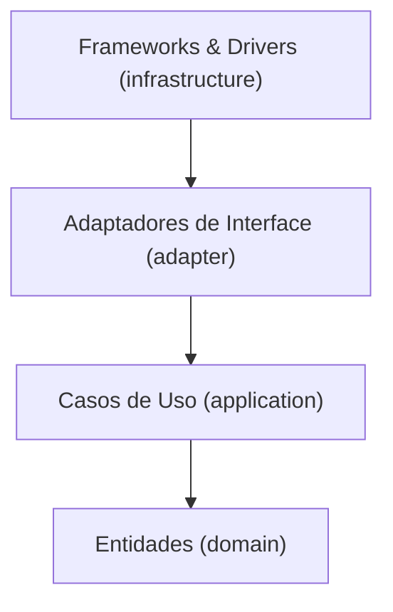

# Sistema de Gestão de Restaurantes — Tech Challenge Fase 2

Back-end para a gestão compartilhada de restaurantes, desenvolvido no **Tech Challenge** da
Pós-Tech em Arquitetura e Desenvolvimento Java. Um grupo de restaurantes decidiu construir uma
plataforma única, em vez de manter sistemas individuais caros, para que o cliente escolha onde
comer pela qualidade da comida, não pela do sistema.

A Fase 2 reconstrói a base em **Clean Architecture**, com testes automatizados em dois níveis e
execução em Docker Compose. O documento de referência da entrega é o
[relatório final](relatorios/relatorio-tech-challenge-fase02-final.md) (também em
[PDF](relatorios/relatorio-tech-challenge-fase02-final.pdf)), que consolida as 29 etapas,
a conformidade com o enunciado, o diagrama do sistema e o roteiro do vídeo. As
[versões anteriores](relatorios/) (v1.0 a v5.0) foram preservadas como histórico detalhado de cada
etapa, com os exemplos de código da época.

## Estado da entrega

Referência: o enunciado da Fase 2 (Tech Challenge). A situação abaixo contempla as 29 etapas
registradas, incluindo endereços, catálogo geográfico, catálogo de produtos, tipos de cozinha e a
revisão final da entrega.

| Requisito do enunciado | Estado |
| --- | --- |
| Usuários: cadastro, consulta, listagem, atualização, exclusão, troca de senha | ✅ Implementado |
| Autenticação JWT, autorização por posse e papel de administrador | ✅ Implementado |
| Recuperação de senha por e-mail (token de uso único com validade) | ✅ Implementado |
| Tipo de usuário: distinguir "Dono de Restaurante" e "Cliente" | ✅ Perfis `owner`, `client`, `courier` e `admin`, em tabelas próprias; o papel é derivado do perfil |
| Tipo de usuário: associar o tipo a usuários **existentes** | ✅ Incluir, alterar e remover perfil em `/api/v1/users/{id}/profiles/…`, valendo na hora |
| Tipo de usuário: **CRUD de tipos de usuário** (campo "Nome do Tipo") | ✅ Atendido pelos perfis — o "tipo" é o perfil (dono, cliente, entregador, administrador), com nome, tabela e campos próprios; incluir, consultar, alterar e remover o tipo de um usuário é feito em `/api/v1/users/{id}/profiles/…`. Detalhes e justificativa no [relatório final](relatorios/relatorio-tech-challenge-fase02-final.md#tipo-de-usuário-como-o-requisito-é-atendido) |
| Cadastro de restaurante: CRUD com nome, endereço, horário de funcionamento e dono | ✅ Implementado — endereço próprio, horário por dia da semana, dono com perfil de dono e regra de posse |
| Cadastro de restaurante: **tipo de cozinha** | ✅ Implementado — catálogo `/api/v1/cuisines` (leitura pública, manutenção do administrador), `cuisineIds` no restaurante e filtro `?cuisineId=` na listagem |
| Cadastro de itens do cardápio (nome, descrição, preço, só no local e imagem) | ✅ CRUD de produtos com caminhos/URLs de imagem, grupos/valores de opção e preço decimal (`BigDecimal` / `numeric(10,2)`) |

| Entregável da avaliação | Estado |
| --- | --- |
| Clean Architecture em camadas | ✅ Quatro camadas, verificadas no build (ArchUnit, 48 regras) |
| Testes: unitários com 80% e de integração | ✅ 939 unitários com **100%** de linhas e ramos; 164 de integração com PostgreSQL real |
| Documentação (arquitetura, endpoints, execução) | ✅ Este README, o relatório técnico, o Swagger, `docs/arquitetura/` e `docs/modelo-dados/` |
| Coleção Postman | ✅ 187 requests, um por retorno documentado de cada endpoint; cobre usuários, perfis, restaurantes, catálogo geográfico, produtos e tipos de cozinha; um print por request; 389 asserções, sem falhas, em duas execuções seguidas |
| Docker Compose (aplicação e banco) | ✅ Aplicação, PostgreSQL e Mailpit |
| Repositório aberto | ✅ Público, com histórico por etapa |
| Vídeo de apresentação (cerca de 5 minutos) | ⏳ A gravar — roteiro pronto no [relatório final](relatorios/relatorio-tech-challenge-fase02-final.md#12-vídeo-de-apresentação) |

## Endereços e catálogo de localidades

Endereços de usuários e restaurantes exigem `cityId` de uma cidade já cadastrada. Consulte
`GET /api/v1/states` e `GET /api/v1/cities?stateId=<id>&name=<nome>&page=0&size=20` para obter os ids.
As consultas são públicas. Cidades e estados só são adicionados por migrations; não há endpoints
de cadastro. A seed inicial contém as 27 unidades federativas, as capitais e Campinas.

```json
{
  "cityId": "c0000000-0000-4000-8000-000000000001",
  "street": "Rua das Flores",
  "number": "100",
  "complement": "Apto 21",
  "neighborhood": "Centro",
  "zipCode": "01001-000"
}
```

A resposta traz `address.city: {id, name, state: {id, name, acronym}}` e o CEP sem máscara.
Cidade ausente ou nula resulta em 400; id de cidade inexistente, em 404. Atualize os clientes que enviavam apenas
`city`/`state`: esses nomes não substituem o id obrigatório. As migrations V11 e V12 preservam
os endereços e vínculos já existentes em um banco na V10; o Flyway as aplica na inicialização.

## Catálogo de produtos

Cada restaurante tem um catálogo em `/api/v1/restaurants/{restaurantId}/products`. As consultas
são públicas; criação, atualização e exclusão exigem o dono do restaurante ou um administrador.
O corpo inclui nome, descrição, preço, indicador `dineInOnly`, caminhos/URLs de imagens em
`imagePaths` e grupos de opções com limites de seleção e preços adicionais. O `PUT` substitui
integralmente o produto, suas imagens e opções.

Esta etapa não envia nem armazena arquivos: `imagePaths` contém referências textuais persistidas
em `images.content`. O preço do produto é enviado como número decimal JSON e representado por
`BigDecimal` na aplicação; a V14 converte `products.price` para `numeric(10,2)`. São aceitos
valores não negativos com até oito dígitos inteiros e duas casas decimais.

## Arquitetura

Quatro camadas concêntricas (Robert C. Martin), com a dependência sempre apontando para dentro:



| Camada | Pacote | Responsabilidade |
|---|---|---|
| Entidades | `domain/entity`, `domain/vo`, `domain/exception` | Regras de negócio e invariantes, sem nenhuma dependência de biblioteca |
| Casos de Uso | `application/usecase`, `application/gateway`, `application/dto` | Uma intenção do ator por classe (`create` + `run`), dependendo só de interfaces |
| Adaptadores de Interface | `adapter/controller`, `adapter/gateway`, `adapter/datasource`, `adapter/service`, `adapter/presenter` | Tradução entre o núcleo e o mundo externo: o controller orquestra, o gateway traduz (inclusive o texto do e-mail e os dados do token), o presenter decide o que sai |
| Frameworks & Drivers | `infrastructure/main`, `api/rest/spring`, `persistence/jpa`, `token/jwt`, `crypto`, `mail/smtp` | Spring, JPA, JWT, SMTP — os únicos detalhes técnicos do sistema |

Dentro de cada camada o código é agrupado por agregado (`user`, `auth`, `address`…), para que a
estrutura revele o domínio. A regra de dependência é **verificada no build** pelo ArchUnit
(17 regras): nenhum tipo fora de `infrastructure` importa Spring, JPA, Hibernate, jjwt ou
Bean Validation.

A infraestrutura, por sua vez, é um conjunto de **módulos substituíveis**: o pacote diz o papel e
o subpacote a tecnologia (`persistence/jpa`, `token/jwt`, `mail/smtp`). Nenhum módulo conhece
outro; só `main` (a composição) liga as pontas. Trocar uma tecnologia é apagar um subpacote e
criar outro ao lado — outras 24 regras ArchUnit provam que nada mais dependia dele, que não há
ciclos entre pacotes, que cada biblioteca só aparece no módulo que a encapsula e que a
infraestrutura só implementa diretamente as portas técnicas (hash de senha, token aleatório,
unidade de trabalho) — o resto passa por um gateway do adaptador; e, dentro da API, que cada
classe está no pacote do seu papel (controller, request, response, assembler, exception).

```
infrastructure/
  main/          composição: liga controllers, portas e módulos
  api/           rest/spring/ — a API REST em Spring, organizada como MVC:
                   controller, dto/request, dto/response, assembler, route, config,
                   exception, doc, security, validation
  persistence/   jpa/ — origens de dados, unidade de trabalho, auditoria
  token/         jwt/ — codifica e lê o token de acesso
  crypto/        BCrypt (senha) e SecureRandom (token de redefinição)
  mail/          smtp/ — transporte do e-mail (o texto é montado no adaptador)
```

Cada camada tem um documento em [`docs/arquitetura/`](docs/arquitetura/README.md) que relaciona o
que as aulas da Fase 2 ensinam, o que os autores de referência (Martin, Cockburn, Freeman, Date,
Machado) dizem e como o projeto implementa — com os padrões adotados, os desvios conscientes e a
regra do build que verifica cada parte.

## Stack

| Tecnologia | Versão | Uso |
|---|---|---|
| Java | 21 | Linguagem |
| Spring Boot | 3.5.11 | Web, Security, Data JPA, Validation, Mail, HATEOAS, Actuator |
| PostgreSQL | 16.15 | Banco de dados |
| Flyway | (Boot) | Versionamento do schema e seed de demonstração |
| jjwt | 0.12.6 | Tokens JWT |
| springdoc-openapi | 2.8.17 | Documentação OpenAPI / Swagger UI |
| Mailpit | 1.31.2 | SMTP de testes com caixa de entrada web |
| JUnit 5, Mockito, Testcontainers, ArchUnit, JaCoCo | (Boot) | Testes unitários, de integração, de arquitetura e cobertura |
| Docker Compose | v2 | Execução local |

## Pré-requisitos

- **Para executar:** Docker com Docker Compose v2. Nada mais — a imagem compila o projeto.
- **Para desenvolver e rodar os testes:** JDK 21, Maven 3.9+ e Docker (os testes de integração
  sobem um PostgreSQL pelo Testcontainers).
- **Para rodar a coleção Postman pela linha de comando:** Node.js (o Newman vem pelo `npx`).

## Execução com Docker Compose

**1. Crie o `.env` e gere um segredo JWT próprio.** O valor do `.env.example` é um marcador e é
**recusado** na subida, de propósito: um segredo publicado no repositório permitiria a qualquer
um assinar um token de administrador.

```bash
cp .env.example .env
```

Gere o segredo com um dos comandos abaixo e cole o resultado em `JWT_SECRET=` no `.env`:

```bash
openssl rand -base64 48
```

```powershell
$b = New-Object byte[] 48; [Security.Cryptography.RandomNumberGenerator]::Create().GetBytes($b); [Convert]::ToBase64String($b)
```

**2. Suba a aplicação, o banco e o Mailpit.** O primeiro build leva alguns minutos (baixa as
dependências dentro da imagem); os seguintes, segundos.

```bash
docker compose up --build
```

**3. Acesse.**

| O quê | Endereço |
|---|---|
| API | `http://localhost:8080/api/v1` |
| Swagger UI | `http://localhost:8080/swagger-ui.html` |
| OpenAPI (JSON) | `http://localhost:8080/v3/api-docs` |
| Saúde | `http://localhost:8080/actuator/health` |
| Caixa de e-mails (Mailpit) | `http://localhost:8025` |

**4. Encerre.** `docker compose down` mantém os dados; `docker compose down -v` apaga o volume
do banco (`restaurantes-fase2_postgres_data`).

Todas as portas são publicadas só em `127.0.0.1`. Se alguma já estiver ocupada na sua máquina,
troque-a no `.env` (`APP_PORT`, `DB_PORT`, `MAIL_PORT`, `MAILPIT_UI_PORT`).

### Rodando a aplicação fora do Docker

Para depurar na IDE, suba só os serviços de apoio e rode a aplicação com as variáveis do `.env`
**carregadas no ambiente**. O Maven e a IDE **não** leem o `.env` — só o Compose lê. Sem carregá-lo,
a aplicação usa os padrões (`localhost:5432`, `localhost:1025`) mesmo que você tenha trocado as
portas no `.env`, e pode acabar ligada a outro PostgreSQL que esteja nessa porta.

```bash
docker compose up -d db mailpit
set -a; . ./.env; set +a          # bash / Git Bash: exporta todas as variáveis do .env
mvn spring-boot:run
```

```powershell
docker compose up -d db mailpit
Get-Content .env | Where-Object { $_ -match '^[A-Z_]+=' } | ForEach-Object { $k, $v = $_ -split '=', 2; Set-Item "env:$k" $v }
mvn spring-boot:run
```

Na IDE, configure as mesmas variáveis na configuração de execução (ou use um plugin de `.env`).

## Variáveis de ambiente

| Variável | Padrão | Descrição |
|---|---|---|
| `JWT_SECRET` | **obrigatória, sem padrão** | Segredo de assinatura do JWT, ≥ 256 bits; valores de exemplo são recusados |
| `JWT_EXPIRATION` | `3600000` | Validade do token, em milissegundos |
| `DB_NAME` / `DB_USER` / `DB_PASSWORD` | `restaurantes-app` / `postgres` / `postgres` | Banco, usuário e senha (valem para o container e para a aplicação) |
| `MAIL_FROM` | `no-reply@restaurantes.postech` | Remetente dos e-mails |
| `PASSWORD_RESET_TOKEN_EXPIRATION_MINUTES` | `30` | Validade do token de redefinição de senha |
| `APP_PORT` / `DB_PORT` / `MAIL_PORT` / `MAILPIT_UI_PORT` | `8080` / `5432` / `1025` / `8025` | Portas no host |
| `DB_HOST` / `MAIL_HOST` | `localhost` | Só fora do Docker; no Compose os serviços se acham pelo nome |
| `MAIL_USERNAME`, `MAIL_PASSWORD`, `MAIL_SMTP_AUTH`, `MAIL_SMTP_STARTTLS` | vazios / `false` | SMTP real, só fora do Docker; no Compose o e-mail vai sempre para o Mailpit |

## Usuários de demonstração

Criados pelas migrations `V2` (usuários) e `V6` (perfis). O administrador só existe por aqui: o
autocadastro não tem perfil de administrador.

| Login | Senha | Perfil | Papel (derivado) |
|---|---|---|---|
| `admin.demo` | `admin12345` | administrador (`ADM-0001`) | `ROLE_ADMIN` |
| `dono.restaurante` | `dono12345` | dono (CNPJ `04.252.011/0001-10`) | `ROLE_OWNER` |
| `cliente.demo` | `cliente12345` | cliente (CPF `529.982.247-25`) | `ROLE_CLIENT` |

A migration `V16` traz o catálogo inicial de tipos de cozinha (Brasileira, Italiana, Japonesa, Árabe, Mexicana,
Vegetariana, Hamburgueria e Pizzaria), com ids fixos `c0000000-0000-4000-8000-000000000001` a `…008`.

## Autenticação e autorização

1. `POST /api/v1/auth/login` com `login` e `password` devolve `{ "token", "type": "Bearer", "expiresAt" }`.
2. As demais chamadas enviam `Authorization: Bearer <token>`. No Swagger UI, use o botão
   **Authorize**.
3. Regras de acesso:
   - Cada usuário lê, altera e exclui **apenas o próprio cadastro**. O administrador acessa qualquer um.
   - A **listagem** de cadastros é exclusiva do administrador, porque expõe dados pessoais de todos.
   - O autocadastro é público e traz um ou mais perfis — `owner` (CNPJ), `client` (CPF) e `courier`
     (CPF; CNH e placa para moto e carro) —, nunca o de administrador. O papel de cada um é derivado
     do perfil: `ROLE_OWNER`, `ROLE_CLIENT`, `ROLE_COURIER`.
   - Restaurante só pode ter como dono um usuário com perfil de dono. O dono cadastra, altera e exclui
     **só os próprios restaurantes** (sem `userId` no cadastro, o dono é quem está autenticado); indicar
     ou trocar o dono é do administrador. Excluir um usuário exclui os restaurantes dele.
   - O restaurante tem horários por dia da semana (`officeHours`: dia, abertura, fechamento), ao menos
     um e sem sobreposição; fechamento antes da abertura é expediente que vira a meia-noite.
   - Produtos pertencem a um restaurante: a consulta do catálogo é pública; criação, atualização
     e exclusão exigem administrador ou o dono daquele restaurante. Imagens são referências
     textuais (`imagePaths`), sem upload de arquivos. O preço usa `BigDecimal` na API e no domínio,
     limitado a duas casas decimais.
   - Perfis de um cadastro existente se incluem, alteram e removem em `/api/v1/users/{id}/profiles/…`
     (o próprio usuário ou um administrador; o perfil de administrador, só um administrador). A
     autorização lê os perfis do cadastro a cada requisição: incluir ou remover perfil vale na hora,
     com o mesmo token. O último administrador não perde o perfil de administrador nem é excluído.
4. **Recuperação de senha:** `POST /api/v1/auth/forgot-password` responde `202` sempre, exista ou
   não o e-mail, e no mesmo tempo: o pedido é processado em segundo plano, então a API não revela
   quais e-mails têm conta nem pela resposta nem pela demora. O token chega **só por e-mail**, em
   instantes: abra
   o Mailpit em `http://localhost:8025`, copie o token e envie em
   `POST /api/v1/auth/reset-password`. Ele vale uma vez e expira em 30 minutos.

## Endpoints

| Método | Rota | Acesso | Sucesso |
|---|---|---|---|
| `POST` | `/api/v1/auth/login` | público | `200` token |
| `POST` | `/api/v1/auth/forgot-password` | público | `202` |
| `POST` | `/api/v1/auth/reset-password` | público | `204` |
| `POST` | `/api/v1/users` | público | `201` + `Location` |
| `GET` | `/api/v1/users?name=&page=&size=&sort=` | administrador | `200` página com links de navegação |
| `GET` | `/api/v1/users/{id}` | dono ou administrador | `200` |
| `PUT` | `/api/v1/users/{id}` | dono ou administrador | `200` |
| `PATCH` | `/api/v1/users/{id}/password` | dono ou administrador | `204` |
| `DELETE` | `/api/v1/users/{id}` | dono ou administrador | `204` (com os restaurantes do usuário; não o último administrador) |
| `PUT` | `/api/v1/users/{id}/profiles/{owner,client,courier}` | dono ou administrador | `200` (inclui ou altera o perfil) |
| `PUT` | `/api/v1/users/{id}/profiles/admin` | administrador | `200` |
| `DELETE` | `/api/v1/users/{id}/profiles/{tipo}` | dono ou administrador | `204` (não o último perfil; não o de dono com restaurante; não o do último administrador) |
| `PATCH` | `/api/v1/users/{id}/profiles/courier/status` | dono ou administrador | `200` |
| `POST` | `/api/v1/restaurants` | dono (para si) ou administrador (para qualquer dono) | `201` + `Location` |
| `GET` | `/api/v1/restaurants?name=&ownerId=&cuisineId=&page=&size=&sort=` | público | `200` página com links de navegação (filtros combináveis) |
| `GET` | `/api/v1/restaurants/{id}` | público | `200` |
| `PUT` | `/api/v1/restaurants/{id}` | dono do restaurante (sem trocar de dono) ou administrador | `200` |
| `DELETE` | `/api/v1/restaurants/{id}` | dono do restaurante ou administrador | `204` |
| `GET` | `/api/v1/cuisines?name=&page=&size=&sort=` | público | `200` página com links de navegação |
| `GET` | `/api/v1/cuisines/{id}` | público | `200` |
| `POST` | `/api/v1/cuisines` | administrador | `201` + `Location` |
| `PUT` | `/api/v1/cuisines/{id}` | administrador | `200` |
| `DELETE` | `/api/v1/cuisines/{id}` | administrador | `204` (não o tipo usado por algum restaurante) |
| `POST` | `/api/v1/restaurants/{restaurantId}/products` | dono do restaurante ou administrador | `201` + `Location` |
| `GET` | `/api/v1/restaurants/{restaurantId}/products?page=&size=` | público | `200` página HATEOAS |
| `GET` | `/api/v1/restaurants/{restaurantId}/products/{productId}` | público | `200` |
| `PUT` | `/api/v1/restaurants/{restaurantId}/products/{productId}` | dono do restaurante ou administrador | `200` (substitui o produto e suas opções) |
| `DELETE` | `/api/v1/restaurants/{restaurantId}/products/{productId}` | dono do restaurante ou administrador | `204` |
| `GET` | `/api/v1/states` | público | `200` lista das 27 unidades federativas |
| `GET` | `/api/v1/cities?stateId=&name=&page=&size=` | público | `200` página com links de navegação |

**Erros** seguem o `ProblemDetail` da RFC 9457 (`application/problem+json`), com `type`, `title`,
`status`, `detail`, `instance` e `timestamp`. O `type` identifica a categoria e é estável — é nele
que o cliente deve se apoiar:

| `type` (`urn:restaurantes:problema:…`) | Status | Quando |
|---|---|---|
| `requisicao-invalida` | 400 | Campo inválido (com o mapa `errors` por campo), JSON malformado, id que não é UUID, nenhum perfil, CPF/CNPJ inválido |
| `senha-invalida` | 400 | Senha atual incorreta ou confirmação divergente |
| `token-invalido` | 400 | Token de redefinição desconhecido, vencido ou já usado |
| `falha-na-autenticacao` | 401 | Login ou senha incorretos (mesma resposta para os dois) |
| `nao-autenticado` | 401 | Sem token ou token inválido/expirado |
| `operacao-nao-permitida` | 403 | Restaurante indicado para usuário sem perfil de dono |
| `acesso-negado` | 403 | Cadastro de outro usuário; listagem por não administrador; restaurante ou produto de outro dono; escrita no catálogo de tipos de cozinha por quem não é administrador |
| `recurso-nao-encontrado` | 404 | Usuário, restaurante, produto ou cidade inexistente; perfil que o usuário não tem; tipo de cozinha inexistente (também em `cuisineIds`) |
| `conflito-de-dados` | 409 | E-mail, login, CPF, CNPJ ou nome de tipo de cozinha já cadastrado |
| `recurso-em-uso` | 409 | Perfil de dono de quem tem restaurante; perfil de administrador ou cadastro do último administrador; tipo de cozinha usado por restaurante |
| `erro-inesperado` | 500 | Falha não prevista (detalhe genérico; a causa vai para o log) |

A documentação completa, com exemplos de cada resposta, está no Swagger UI.

## Coleção Postman

[`postman/Restaurantes.postman_collection.json`](postman/Restaurantes.postman_collection.json)
(formato v2.1) tem **187 requests em 19 pastas** (usuários, restaurantes, catálogo geográfico, produtos e tipos de cozinha): um por caso de cada endpoint — o sucesso e cada
erro previsto —, na ordem em que rodam de cima a baixo. Os scripts de teste conferem o status e
o `type` de cada erro e guardam `{{adminToken}}`, `{{token}}` e `{{userId}}` para as requisições
seguintes; se um login ou cadastro essencial falhar, a execução para ali, com o motivo, em vez de
seguir falhando em cascata. A pasta de recuperação de senha lê o token **na caixa do Mailpit**,
pela API dele, como o usuário faria.

A pasta de produtos cobre o catálogo: criação, consulta, listagem paginada, substituição e
exclusão, incluindo os status documentados para validação, autenticação, posse e recurso inexistente.
Nos requests de criação e atualização,
`imagePaths` é uma lista de caminhos ou URLs de imagem (por exemplo, `/images/pizza.jpg`). Nenhum
arquivo é enviado ou armazenado; cada referência é persistida como texto na coluna `images.content`.

A coleção cria os próprios usuários — um cliente, um segundo cadastro descartável (alvo dos
casos de acesso negado), um dono e um entregador — e os exclui ao fim. CPF, CNPJ e CNH são únicos
no banco: o pré-request da coleção gera documentos válidos e novos a cada request
(`{{cpfGerado}}`, `{{cnpjGerado}}`, `{{cnhGerada}}`). **Ela nunca altera os usuários da seed**: se a regra
de posse regredir, o estrago fica no cadastro descartável. O único caso que mira a seed — excluir o
administrador dela, o último, e receber `409` — só mira depois que a listagem confirma que ele é o único
administrador; senão vai para um id inexistente e falha sem apagar nada. Por isso pode rodar quantas vezes
quiser contra o mesmo banco.

- **No Postman:** *Import* → escolha o arquivo → *Run collection*. As variáveis `baseUrl`
  (`http://localhost:8080`) e `mailpitUrl` (`http://localhost:8025`) ficam na própria coleção.
- **Na linha de comando**, com a pilha no ar:

```bash
npx newman@6 run postman/Restaurantes.postman_collection.json
```

Com a pilha no Docker Compose, a coleção usa `http://localhost:8080` para a API e
`http://localhost:8025` para o Mailpit. Ao executar a aplicação fora do Compose, o padrão da API
é `http://localhost:8081`; nesse caso, sobrescreva a URL da API:

```bash
npx newman@6 run postman/Restaurantes.postman_collection.json \
  --env-var baseUrl=http://localhost:8081
```

Se as portas do host foram alteradas no `.env`, informe os valores de `APP_PORT` e
`MAILPIT_UI_PORT` correspondentes com `--env-var baseUrl=...` e `--env-var mailpitUrl=...`.

Os prints da coleção estão em [`postman/prints/`](postman/prints/): **um por request**, com o número
do request no nome do arquivo (a numeração segue a ordem de execução, de 01 em diante). Cada imagem
registra o request, a resposta e os testes da chamada; tokens JWT aparecem abreviados.

Para regenerar os prints da coleção completa com a pilha no ar:

```bash
npx newman@6 run postman/Restaurantes.postman_collection.json --reporters cli,json --reporter-json-export target/newman.json
node postman/gerar-prints.js target/newman.json postman/Restaurantes.postman_collection.json postman/prints
```

O script usa o Chrome em modo headless; fora do Windows, aponte `CHROME_PATH` para o executável.
Os prints existentes só são substituídos depois que todos os novos forem gerados.

## Testes

```bash
mvn test      # unitários + regras ArchUnit — segundos, sem Docker
mvn verify    # + testes de integração (Testcontainers) + gate de 100% de cobertura
```

- **Unitários (939):** entidades sem mocks; casos de uso com mocks das portas; adaptadores com
  mocks das origens de dados e dos serviços; infraestrutura com lógica instanciada diretamente. Nenhum sobe
  contexto Spring nem toca em banco. Cobertura JaCoCo unitária de **100% de linhas e ramos**
  (2766 linhas e 626 ramos).
- **Integração (164):** contexto Spring completo, PostgreSQL real, migrations do Flyway,
  segurança JWT ativa e chamadas HTTP de verdade. Nenhum bean é substituído, exceto o envio de
  e-mail.
- **Cobertura:** o build **falha** abaixo de 100% de linhas e ramos **dos testes unitários**. A
  integração é medida à parte, só para informação. Relatórios: `target/site/jacoco/index.html`
  (unitários) e `target/site/jacoco-it/index.html` (integração).
- **Arquitetura e convenções:** o ArchUnit verifica a regra de dependência (17 regras), os módulos
  da infraestrutura (24 regras) e as
  convenções da própria suíte (7 regras: `@DisplayName` em todo teste, nome `should…`/`shouldNot…` — os legados `deve…` continuam aceitos —, unitário
  sem contexto Spring, integração sem dublê de bean da aplicação…).

## Estrutura do repositório

```
src/main/java/com/postech/restaurantes/
  domain/          entidades, objetos de valor e exceções de negócio
  application/     casos de uso, portas (gateways) e DTOs do núcleo
  adapter/         controllers, gateways, origens de dados, serviços externos e presenters
  infrastructure/  módulos substituíveis: main, api/rest/spring, persistence/jpa, token/jwt, crypto, mail/smtp
src/main/resources/db/migration/   V1–V17 (schema, catálogo, migrações e seeds; V15 a V17: tipos de cozinha)
postman/                           coleção e prints
relatorios/                        relatório final (Markdown e PDF, gerado por gerar-pdf.js) e as versões v1.0 a v5.0 (histórico)
docs/arquitetura/                  cada camada: o que as aulas ensinam, o que os autores dizem, como o projeto faz
```
