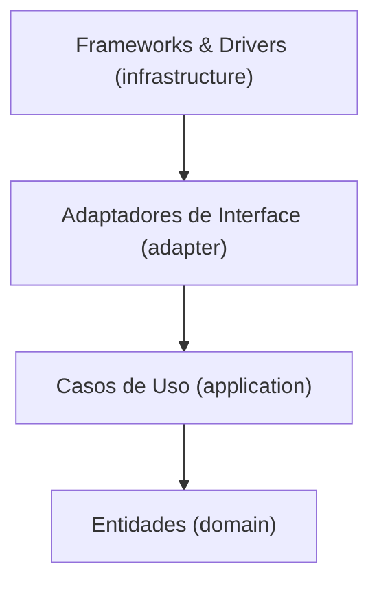

# Sistema de Gestão de Restaurantes — Tech Challenge Fase 2

Back-end para a gestão compartilhada de restaurantes, desenvolvido no **Tech Challenge** da Pós-Tech em
Arquitetura e Desenvolvimento Java.

**O problema.** Um grupo de restaurantes da região decidiu construir um sistema de gestão **único e
compartilhado**, em vez de manter sistemas individuais caros, para que o cliente escolha onde comer pela
comida, e não pela qualidade do sistema. A entrega acontece em fases.

**O objetivo da Fase 2.** Expandir o sistema com a gestão dos **tipos de usuário**, o **cadastro de
restaurantes** e o **cadastro dos itens do cardápio**, com código limpo, documentação, testes automatizados
e execução integrada em Docker. O projeto foi construído do zero em **Clean Architecture**.

**Grupo 17**

| Integrante | RM |
| --- | --- |
| Felipe Dias Mac Dowell | `@rm375442` |
| Francisco Ferreira de Araujo | `@rm375897` |
| Rafael Brandão Silva | `@rm376160` |
| Rodrigo do Carmo Cruz | `@rm377016` |
| Ana Melissa | `@rm375443` |

| Link | |
| --- | --- |
| Repositório | <https://github.com/felipe11dias/postech-fase2-restaurantes-app> |
| Vídeo de apresentação | <https://www.youtube.com/watch?v=N0ckKiKnPcw> |
| Relatório técnico final | [Markdown](relatorios/relatorio-tech-challenge-fase02-final.md) · [PDF](relatorios/relatorio-tech-challenge-fase02-final.pdf) |
| Coleção Postman | [`postman/Restaurantes.postman_collection.json`](postman/Restaurantes.postman_collection.json) |
| Swagger UI (com a aplicação no ar) | `http://localhost:8080/swagger-ui.html` |

## Sumário

1. [Atendimento ao enunciado](#atendimento-ao-enunciado)
2. [Entregáveis e fatores de avaliação](#entregáveis-e-fatores-de-avaliação)
3. [Arquitetura](#arquitetura)
4. [Como executar](#como-executar)
5. [Endpoints](#endpoints)
6. [Coleção Postman](#coleção-postman)
7. [Testes](#testes)
8. [Estrutura do repositório](#estrutura-do-repositório)
9. [Documentação complementar](#documentação-complementar)

## Atendimento ao enunciado

### Tipo de usuário

**O enunciado pede** uma estrutura para distinguir "Dono de Restaurante" e "Cliente", um CRUD de tipos de
usuário com o campo "Nome do Tipo" e uma forma de associar o tipo a usuários existentes.

**O projeto atende** com **perfis**. Cada tipo de usuário é um perfil com nome, tabela, campos e regras
próprios:

| Tipo (`ProfileType`) | Tabela | Campos próprios | Papel derivado |
| --- | --- | --- | --- |
| `OWNER` — dono | `owners` | CNPJ, razão social, telefone comercial | `ROLE_OWNER` |
| `CLIENT` — cliente | `clients` | CPF, telefone, nascimento | `ROLE_CLIENT` |
| `COURIER` — entregador | `couriers` | CPF, veículo, CNH, placa, status | `ROLE_COURIER` |
| `ADMIN` — administrador | `admins` | código de funcionário, departamento | `ROLE_ADMIN` |

| Operação sobre o tipo de um usuário | Endpoint |
| --- | --- |
| Associar no cadastro | `POST /api/v1/users` (um ou mais perfis; nunca o de administrador) |
| Associar a um usuário **existente** ou alterar | `PUT /api/v1/users/{id}/profiles/{owner,client,courier,admin}` |
| Consultar | `GET /api/v1/users/{id}` (perfis e `roles` na resposta) |
| Remover | `DELETE /api/v1/users/{id}/profiles/{tipo}` |

O papel de autorização é **derivado** do perfil e nunca é gravado. Incluir ou remover um perfil vale na hora,
com o mesmo token. Um usuário pode ter vários perfis ao mesmo tempo e precisa ter ao menos um.

O tipo é um perfil, e não uma tabela só de nomes editável em tempo de execução, porque cada tipo carrega
campos, restrições e regras de autorização. A justificativa completa está no relatório final, em
[Tipo de usuário: como o requisito é atendido](relatorios/relatorio-tech-challenge-fase02-final.md#tipo-de-usuário-como-o-requisito-é-atendido).

### Cadastro de restaurante

O CRUD completo fica em `/api/v1/restaurants` (`POST`, `GET` por id, `GET` paginado com filtros, `PUT` e
`DELETE`).

| Campo do enunciado | No cadastro | Regras |
| --- | --- | --- |
| Nome | `name` | obrigatório |
| Endereço | `address` com `cityId` | cidade do catálogo geográfico (`GET /api/v1/states`, `GET /api/v1/cities?stateId=&name=`); CEP de 8 dígitos |
| Tipo de cozinha | `cuisineIds` | ids do catálogo `/api/v1/cuisines`; a listagem filtra por `?cuisineId=` |
| Horário de funcionamento | `officeHours`: `dayOfWeek`, `startTime`, `endTime` | ao menos um horário e sem sobreposição; fechamento antes da abertura é expediente que vira a meia-noite |
| Dono | `userId` | usuário com perfil de dono; sem `userId`, o dono é quem está autenticado |

Exemplo de endereço (mesmo formato no cadastro de usuário):

```json
{
  "cityId": "c0000000-0000-4000-8000-000000000001",
  "street": "Rua das Flores",
  "number": "100",
  "complement": "Apto 21",
  "neighborhood": "Centro",
  "zipCode": "01001-000"
}
```

A resposta traz `address.city: {id, name, state: {id, name, acronym}}` e o CEP sem máscara. Cidade ausente
resulta em 400; cidade inexistente, em 404. Cidades e estados entram só por migration: a seed tem as 27
unidades federativas, as capitais e Campinas.

O catálogo de tipos de cozinha tem leitura pública e manutenção só do administrador. Ele já vem com 38
tipos: a migration `V16` traz oito (Brasileira, Italiana, Japonesa, Árabe, Mexicana, Vegetariana, Hamburgueria e
Pizzaria), com ids `c0000000-0000-4000-8000-000000000001` a `…008`, e a `V18` acrescenta trinta, de Açaí a Vegana,
com ids `…010` a `…039`. O dono altera e exclui só os próprios restaurantes; indicar ou trocar o dono é do
administrador.

### Cadastro dos itens do cardápio

Cada restaurante tem o seu cardápio em `/api/v1/restaurants/{restaurantId}/products` (`POST`, `GET` por id, `GET`
paginado, `PUT` e `DELETE`). A consulta é pública; a escrita é do dono do restaurante ou de um administrador.

| Campo do enunciado | No cadastro | Regras |
| --- | --- | --- |
| Nome | `name` | obrigatório |
| Descrição | `description` | — |
| Preço | `price` | decimal (`BigDecimal` na aplicação, `numeric(10,2)` no banco), não negativo, até oito dígitos inteiros e duas casas |
| Disponível só no restaurante | `dineInOnly` | booleano |
| Foto do prato | `imagePaths` | lista de caminhos ou URLs, guardados como texto em `images.content`; nenhum arquivo é enviado, como o enunciado permite |

O produto também aceita grupos de opções (`optionGroups`), com limites de seleção e preço adicional por
valor. O `PUT` substitui o produto inteiro, com as imagens e as opções.

## Entregáveis e fatores de avaliação

| Fator do enunciado | Status | Onde está |
| --- | --- | --- |
| 1. Funcionalidade: tipo de usuário, restaurante e itens do cardápio, com os endpoints funcionando | ✅ | [Atendimento ao enunciado](#atendimento-ao-enunciado) e [Endpoints](#endpoints); 32 operações REST, todas exercitadas pela coleção Postman (187 requests e 392 asserções, sem falhas) |
| 2. Qualidade do código: práticas do Spring Boot, código organizado e documentado | ✅ | Spring Boot 3.5 com Security, Data JPA, Validation, HATEOAS, Actuator e springdoc; um `package-info.java` por pacote dizendo a regra dele; organização verificada no build (ArchUnit) |
| 3. Documentação: arquitetura, endpoints, configuração e execução | ✅ | Este README; o [relatório final](relatorios/relatorio-tech-challenge-fase02-final.md); o Swagger UI; [`docs/arquitetura/`](docs/arquitetura/README.md); [`docs/modelo-dados/`](docs/modelo-dados/README.md) |
| 4. Collections para teste | ✅ | [`postman/`](#coleção-postman): 187 requests em 19 pastas, um por retorno documentado de cada endpoint, com um print por request |
| 5. Docker Compose com a aplicação Java e o banco | ✅ | [`docker-compose.yml`](docker-compose.yml): aplicação, PostgreSQL 16.15 e Mailpit, com healthchecks ([Como executar](#como-executar)) |
| 6. Repositório de código aberto | ✅ | <https://github.com/felipe11dias/postech-fase2-restaurantes-app>, com histórico por etapa |
| 7. Clean Architecture em camadas | ✅ | `domain`, `application`, `adapter` e `infrastructure`; 48 regras ArchUnit quebram o build se a regra de dependência for violada ([Arquitetura](#arquitetura)) |
| 8. Testes: unitários com 80% de cobertura e de integração | ✅ | 939 unitários com **100%** de linhas e ramos, exigidos pelo build; 165 de integração com PostgreSQL real ([Testes](#testes)) |
| 9. Vídeo de cerca de 5 minutos | ✅ | <https://www.youtube.com/watch?v=N0ckKiKnPcw> (o roteiro está no [relatório final](relatorios/relatorio-tech-challenge-fase02-final.md#12-vídeo-de-apresentação)) |

## Arquitetura

Quatro camadas concêntricas (Robert C. Martin), com a dependência sempre apontando para dentro:



| Camada | Pacote | Responsabilidade |
|---|---|---|
| Entidades | `domain` | Regras de negócio e invariantes, sem nenhuma dependência de biblioteca |
| Casos de Uso | `application` | Uma intenção do ator por classe (`create` + `run`), dependendo só de interfaces (portas) |
| Adaptadores de Interface | `adapter` | Tradução entre o núcleo e o mundo externo: o controller orquestra, o gateway traduz, o presenter decide o que sai |
| Frameworks & Drivers | `infrastructure` | Spring, JPA, JWT e SMTP: os únicos detalhes técnicos do sistema |

**Fluxo de uma requisição.**
1. O `@RestController` (infraestrutura) valida a sintaxe e chama o controller de adaptação.
2. O controller de adaptação cria o gateway e o caso de uso e executa `run` dentro de uma unidade de trabalho.
3. O caso de uso aplica as regras de aplicação e usa as entidades, que validam as próprias invariantes.
4. O gateway traduz a entidade para a origem de dados JPA.
5. Na volta, o presenter monta a *view*, e o `@RestController` devolve o JSON com links HATEOAS.

Erros saem como `ProblemDetail` (RFC 9457), traduzidos num lugar só.

**O build verifica a arquitetura**, com 48 regras ArchUnit:
- **`ArchitectureTest` (17 regras):** nenhum tipo fora de `infrastructure` importa Spring, JPA, Hibernate, jjwt ou Bean Validation.
- **`InfrastructureModulesTest` (24 regras):** os módulos da infraestrutura não se conhecem, e não há ciclos entre pacotes.
- **`TestConventionsTest` (7 regras):** a própria suíte segue as convenções.

Dentro de cada camada, o código é agrupado por agregado (`user`, `restaurant`, `product`, `cuisine`…), para
que a estrutura revele o domínio. A infraestrutura é um conjunto de **módulos substituíveis**:
- o pacote diz o papel, e o subpacote, a tecnologia (`persistence/jpa`, `token/jwt`, `mail/smtp`);
- só `main` (a composição) liga as pontas;
- trocar uma tecnologia é apagar um subpacote e criar outro ao lado.

Cada camada tem um documento em [`docs/arquitetura/`](docs/arquitetura/README.md) que relaciona três fontes:
- o que as aulas da Fase 2 ensinam;
- o que os autores de referência dizem (Martin, Cockburn, Freeman, Date, Machado);
- como o projeto implementa: padrões, desvios conscientes e a regra do build que verifica cada parte.

O diagrama lógico está em [`arquitetura-logica.md`](arquitetura-logica.md).

### Stack

| Tecnologia | Versão | Uso |
|---|---|---|
| Java | 21 | Linguagem |
| Spring Boot | 3.5.11 | Web, Security, Data JPA, Validation, Mail, HATEOAS, Actuator |
| PostgreSQL | 16.15 | Banco de dados |
| Flyway | (Boot) | Versionamento do schema e seeds |
| jjwt | 0.12.6 | Tokens JWT |
| springdoc-openapi | 2.8.17 | Documentação OpenAPI / Swagger UI |
| Mailpit | 1.31.2 | SMTP de testes com caixa de entrada web |
| JUnit 5, Mockito, Testcontainers, ArchUnit 1.4.2, JaCoCo 0.8.13 | — | Testes unitários, de integração, de arquitetura e cobertura |
| Docker Compose | v2 | Execução local |

## Como executar

### Pré-requisitos

- **Para executar:** só Docker com Docker Compose v2. A imagem compila o projeto.
- **Para desenvolver e rodar os testes:** JDK 21, Maven 3.9+ e Docker. Os testes de integração sobem um
  PostgreSQL pelo Testcontainers.
- **Para rodar a coleção Postman pela linha de comando:** Node.js. O Newman vem pelo `npx`.

### Com Docker Compose

**1. Crie o `.env` e gere um segredo JWT próprio.** O valor do `.env.example` é um marcador e é **recusado** na
subida, de propósito: um segredo publicado no repositório permitiria a qualquer um assinar um token de
administrador.

```bash
cp .env.example .env
```

Gere o segredo com um dos comandos abaixo e cole o resultado em `JWT_SECRET=` no `.env`:

```bash
openssl rand -base64 48
```

```powershell
$b = New-Object byte[] 48; [Security.Cryptography.RandomNumberGenerator]::Create().GetBytes($b); [Convert]::ToBase64String($b)
```

**2. Suba a aplicação, o banco e o Mailpit.** O primeiro build leva alguns minutos, porque baixa as dependências
dentro da imagem. Os seguintes levam segundos. O Flyway aplica as migrations na subida.

```bash
docker compose up --build
```

**3. Acesse.**

| O quê | Endereço |
|---|---|
| API | `http://localhost:8080/api/v1` |
| Swagger UI | `http://localhost:8080/swagger-ui.html` |
| OpenAPI (JSON) | `http://localhost:8080/v3/api-docs` |
| Saúde | `http://localhost:8080/actuator/health` |
| Caixa de e-mails (Mailpit) | `http://localhost:8025` |

**4. Encerre.** `docker compose down` mantém os dados; `docker compose down -v` apaga o volume do banco
(`restaurantes-fase2_postgres_data`).

Todas as portas são publicadas só em `127.0.0.1`. Se alguma já estiver ocupada na sua máquina, troque-a no
`.env` (`APP_PORT`, `DB_PORT`, `MAIL_PORT`, `MAILPIT_UI_PORT`).

### Fora do Docker (depuração na IDE)

Suba só os serviços de apoio e rode a aplicação com as variáveis do `.env` **carregadas no ambiente**. O Maven
e a IDE **não** leem o `.env`; só o Compose lê. Sem carregá-lo, a aplicação usa os padrões (`localhost:5432`,
`localhost:1025`) mesmo que você tenha trocado as portas no `.env`, e pode acabar ligada a outro PostgreSQL que
esteja nessa porta. Fora do Compose, a API responde na porta `8081`.

```bash
docker compose up -d db mailpit
set -a; . ./.env; set +a          # bash / Git Bash: exporta todas as variáveis do .env
mvn spring-boot:run
```

```powershell
docker compose up -d db mailpit
Get-Content .env | Where-Object { $_ -match '^[A-Z_]+=' } | ForEach-Object { $k, $v = $_ -split '=', 2; Set-Item "env:$k" $v }
mvn spring-boot:run
```

Na IDE, configure as mesmas variáveis na configuração de execução (ou use um plugin de `.env`).

### Variáveis de ambiente

| Variável | Padrão | Descrição |
|---|---|---|
| `JWT_SECRET` | **obrigatória, sem padrão** | Segredo de assinatura do JWT, com 256 bits ou mais; valores de exemplo são recusados |
| `JWT_EXPIRATION` | `3600000` | Validade do token, em milissegundos |
| `DB_NAME` / `DB_USER` / `DB_PASSWORD` | `restaurantes-app` / `postgres` / `postgres` | Banco, usuário e senha (valem para o container e para a aplicação) |
| `MAIL_FROM` | `no-reply@restaurantes.postech` | Remetente dos e-mails |
| `PASSWORD_RESET_TOKEN_EXPIRATION_MINUTES` | `30` | Validade do token de redefinição de senha |
| `APP_PORT` / `DB_PORT` / `MAIL_PORT` / `MAILPIT_UI_PORT` | `8080` / `5432` / `1025` / `8025` | Portas no host |
| `DB_HOST` / `MAIL_HOST` | `localhost` | Só fora do Docker; no Compose, os serviços se acham pelo nome |
| `MAIL_USERNAME`, `MAIL_PASSWORD`, `MAIL_SMTP_AUTH`, `MAIL_SMTP_STARTTLS` | vazios / `false` | SMTP real, só fora do Docker; no Compose, o e-mail vai sempre para o Mailpit |

### Usuários de demonstração

Criados pelas migrations `V2` (usuários) e `V6` (perfis). O administrador só existe por aqui: o autocadastro
não concede o perfil de administrador.

| Login | Senha | Perfil | Papel (derivado) |
|---|---|---|---|
| `admin.demo` | `admin12345` | administrador (`ADM-0001`) | `ROLE_ADMIN` |
| `dono.restaurante` | `dono12345` | dono (CNPJ `04.252.011/0001-10`) | `ROLE_OWNER` |
| `cliente.demo` | `cliente12345` | cliente (CPF `529.982.247-25`) | `ROLE_CLIENT` |

## Endpoints

### Autenticação e autorização

1. `POST /api/v1/auth/login` com `login` e `password` devolve `{ "token", "type": "Bearer", "expiresAt" }`.
2. As demais chamadas enviam `Authorization: Bearer <token>`. No Swagger UI, use o botão **Authorize**.
3. Regras de acesso:
   - Cada usuário lê, altera e exclui **apenas o próprio cadastro**. O administrador acessa qualquer um.
   - A **listagem** de cadastros é exclusiva do administrador, porque expõe dados pessoais de todos.
   - O autocadastro é público e traz um ou mais perfis: `owner` (CNPJ), `client` (CPF) e `courier` (CPF; CNH e
     placa para moto e carro). Nunca traz o de administrador.
   - O dono cadastra, altera e exclui **só os próprios restaurantes** e o cardápio deles. Excluir um usuário exclui
     os restaurantes dele.
   - O último administrador não perde o perfil de administrador nem é excluído.
4. **Recuperação de senha:** `POST /api/v1/auth/forgot-password` responde `202` sempre, no mesmo tempo, exista ou
   não o e-mail. O pedido é processado em segundo plano, então a API não revela quais e-mails têm conta, nem
   pela resposta nem pela demora. O token chega **só por e-mail**, em instantes:
   1. abra o Mailpit em `http://localhost:8025`;
   2. copie o token;
   3. envie-o em `POST /api/v1/auth/reset-password`.

   O token vale uma vez e expira em 30 minutos.

### Operações

| Método | Rota | Acesso | Sucesso |
|---|---|---|---|
| `POST` | `/api/v1/auth/login` | público | `200` token |
| `POST` | `/api/v1/auth/forgot-password` | público | `202` |
| `POST` | `/api/v1/auth/reset-password` | público | `204` |
| `POST` | `/api/v1/users` | público | `201` + `Location` |
| `GET` | `/api/v1/users?name=&page=&size=&sort=` | administrador | `200` página com links de navegação |
| `GET` | `/api/v1/users/{id}` | o próprio ou administrador | `200` |
| `PUT` | `/api/v1/users/{id}` | o próprio ou administrador | `200` |
| `PATCH` | `/api/v1/users/{id}/password` | o próprio ou administrador | `204` |
| `DELETE` | `/api/v1/users/{id}` | o próprio ou administrador | `204` (com os restaurantes do usuário; não o último administrador) |
| `PUT` | `/api/v1/users/{id}/profiles/{owner,client,courier}` | o próprio ou administrador | `200` (inclui ou altera o perfil) |
| `PUT` | `/api/v1/users/{id}/profiles/admin` | administrador | `200` |
| `DELETE` | `/api/v1/users/{id}/profiles/{tipo}` | o próprio ou administrador | `204` (não o último perfil; não o de dono com restaurante; não o do último administrador) |
| `PATCH` | `/api/v1/users/{id}/profiles/courier/status` | o próprio ou administrador | `200` |
| `POST` | `/api/v1/restaurants` | dono (para si) ou administrador (para qualquer dono) | `201` + `Location` |
| `GET` | `/api/v1/restaurants?name=&ownerId=&cuisineId=&page=&size=&sort=` | público | `200` página com links de navegação (filtros combináveis) |
| `GET` | `/api/v1/restaurants/{id}` | público | `200` |
| `PUT` | `/api/v1/restaurants/{id}` | dono do restaurante (sem trocar de dono) ou administrador | `200` |
| `DELETE` | `/api/v1/restaurants/{id}` | dono do restaurante ou administrador | `204` |
| `POST` | `/api/v1/restaurants/{restaurantId}/products` | dono do restaurante ou administrador | `201` + `Location` |
| `GET` | `/api/v1/restaurants/{restaurantId}/products?page=&size=` | público | `200` página HATEOAS |
| `GET` | `/api/v1/restaurants/{restaurantId}/products/{productId}` | público | `200` |
| `PUT` | `/api/v1/restaurants/{restaurantId}/products/{productId}` | dono do restaurante ou administrador | `200` (substitui o produto e suas opções) |
| `DELETE` | `/api/v1/restaurants/{restaurantId}/products/{productId}` | dono do restaurante ou administrador | `204` |
| `GET` | `/api/v1/cuisines?name=&page=&size=&sort=` | público | `200` página com links de navegação |
| `GET` | `/api/v1/cuisines/{id}` | público | `200` |
| `POST` | `/api/v1/cuisines` | administrador | `201` + `Location` |
| `PUT` | `/api/v1/cuisines/{id}` | administrador | `200` |
| `DELETE` | `/api/v1/cuisines/{id}` | administrador | `204` (não o tipo usado por algum restaurante) |
| `GET` | `/api/v1/states` | público | `200` lista das 27 unidades federativas |
| `GET` | `/api/v1/cities?stateId=&name=&page=&size=` | público | `200` página com links de navegação |

### Erros

Os erros seguem o `ProblemDetail` da RFC 9457 (`application/problem+json`), com `type`, `title`, `status`,
`detail`, `instance` e `timestamp`. O `type` identifica a categoria e é estável: é nele que o cliente deve se
apoiar.

| `type` (`urn:restaurantes:problema:…`) | Status | Quando |
|---|---|---|
| `requisicao-invalida` | 400 | Campo inválido (com o mapa `errors` por campo), JSON malformado, id que não é UUID, nenhum perfil, CPF/CNPJ inválido |
| `senha-invalida` | 400 | Senha atual incorreta ou confirmação divergente |
| `token-invalido` | 400 | Token de redefinição desconhecido, vencido ou já usado |
| `falha-na-autenticacao` | 401 | Login ou senha incorretos (mesma resposta para os dois) |
| `nao-autenticado` | 401 | Sem token ou token inválido/expirado |
| `operacao-nao-permitida` | 403 | Restaurante indicado para usuário sem perfil de dono |
| `acesso-negado` | 403 | Cadastro de outro usuário; listagem por não administrador; restaurante ou produto de outro dono; escrita no catálogo de tipos de cozinha por quem não é administrador |
| `recurso-nao-encontrado` | 404 | Usuário, restaurante, produto ou cidade inexistente; perfil que o usuário não tem; tipo de cozinha inexistente (também em `cuisineIds`) |
| `conflito-de-dados` | 409 | E-mail, login, CPF, CNPJ ou nome de tipo de cozinha já cadastrado |
| `recurso-em-uso` | 409 | Perfil de dono de quem tem restaurante; perfil de administrador ou cadastro do último administrador; tipo de cozinha usado por restaurante |
| `erro-inesperado` | 500 | Falha não prevista (detalhe genérico; a causa vai para o log) |

A documentação completa, com exemplos de cada resposta, está no Swagger UI.

## Coleção Postman

A coleção [`postman/Restaurantes.postman_collection.json`](postman/Restaurantes.postman_collection.json)
(formato v2.1) tem **187 requests em 19 pastas**: usuários, perfis, restaurantes, produtos, catálogo geográfico e
tipos de cozinha.
- **Cobertura:** há um request por caso de cada endpoint, ou seja, o sucesso e cada erro documentado. Eles estão
  na ordem em que rodam, de cima a baixo.
- **Asserções:** os scripts de teste conferem o status e o `type` de cada erro.
- **Variáveis:** os scripts guardam `{{adminToken}}`, `{{token}}` e `{{userId}}` para os requests seguintes.
- **Parada na falha:** se um login ou cadastro essencial falhar, a execução para ali, com o motivo.
- **Recuperação de senha:** a pasta lê o token **na caixa do Mailpit**, pela API dele, como o usuário faria.

A coleção cria os próprios usuários e os exclui ao fim:
- os cadastros criados são um cliente, um cadastro descartável (alvo dos casos de acesso negado), um dono e um entregador;
- CPF, CNPJ e CNH são gerados válidos e novos a cada request (`{{cpfGerado}}`, `{{cnpjGerado}}`, `{{cnhGerada}}`);
- **os usuários da seed nunca são alterados.**

Por isso a coleção pode rodar quantas vezes você quiser contra o mesmo banco. Os cadastros de restaurante usam
os tipos de cozinha da seed (`cuisineIds`).

- **No Postman:** *Import* → escolha o arquivo → *Run collection*. As variáveis `baseUrl` (`http://localhost:8080`)
  e `mailpitUrl` (`http://localhost:8025`) ficam na própria coleção.
- **Na linha de comando**, com a pilha no ar:

```bash
npx newman@6 run postman/Restaurantes.postman_collection.json
```

Com a aplicação fora do Compose (porta `8081`), ou com outras portas no `.env`, sobrescreva as URLs:

```bash
npx newman@6 run postman/Restaurantes.postman_collection.json \
  --env-var baseUrl=http://localhost:8081 --env-var mailpitUrl=http://localhost:8025
```

**Prints.** Os prints ficam em [`postman/prints/`](postman/prints/), **um por request**. O nome de cada arquivo
começa pelo número do request, na ordem de execução. Cada imagem mostra o request, a resposta e os testes; os
tokens JWT aparecem abreviados. Para regenerar os prints com a pilha no ar, rode os dois comandos abaixo. O
script usa o Chrome em modo headless; fora do Windows, defina `CHROME_PATH`.

```bash
npx newman@6 run postman/Restaurantes.postman_collection.json --reporters cli,json --reporter-json-export target/newman.json
node postman/gerar-prints.js target/newman.json postman/Restaurantes.postman_collection.json postman/prints
```

## Testes

```bash
mvn test      # unitários + regras ArchUnit — segundos, sem Docker
mvn verify    # + testes de integração (Testcontainers) + gate de 100% de cobertura
```

- **Unitários (939):** nenhum sobe contexto Spring nem toca em banco.
  - Entidades sem mocks.
  - Casos de uso com mocks das portas.
  - Adaptadores com mocks das origens de dados e dos serviços.
  - Infraestrutura com a lógica instanciada diretamente.
- **Integração (165):** contexto Spring completo, PostgreSQL real, migrations do Flyway, segurança JWT ativa e
  chamadas HTTP de verdade. Nenhum bean da aplicação é substituído, exceto o envio de e-mail.
- **Cobertura:** o enunciado pede 80%. O build **falha** abaixo de **100% de linhas e ramos** dos testes unitários
  (hoje, 2766 linhas e 626 ramos). A integração é medida à parte, só para informação. Os relatórios ficam em
  `target/site/jacoco/index.html` (unitários) e `target/site/jacoco-it/index.html` (integração).
- **Arquitetura e convenções:** 48 regras ArchUnit.
  - Regra de dependência: 17.
  - Módulos da infraestrutura: 24.
  - Convenções da suíte: 7. Por exemplo, `@DisplayName` em todo teste, nome `should…`/`shouldNot…` (os legados `deve…` continuam aceitos), unitário sem Spring e integração sem dublê de bean da aplicação.

## Estrutura do repositório

### Raiz

| Arquivo ou pasta | Para que serve |
| --- | --- |
| [`README.md`](README.md) | Este documento: o que o projeto entrega, como executar e onde está cada coisa |
| [`pom.xml`](pom.xml) | Build Maven: dependências, versões, Surefire (unitários), Failsafe (`*IT`) e o gate de 100% do JaCoCo |
| [`Dockerfile`](Dockerfile) | Imagem da aplicação em dois estágios: compila com Maven e roda num JRE 21 Alpine, como usuário sem privilégio |
| [`docker-compose.yml`](docker-compose.yml) | Sobe a aplicação, o PostgreSQL e o Mailpit, com healthchecks e portas só em `127.0.0.1` |
| [`.env.example`](.env.example) | Modelo do `.env` com as variáveis de ambiente; o `.env` real não é versionado |
| [`.dockerignore`](.dockerignore) | Deixa fora do contexto de build tudo o que a imagem não usa (documentação, vídeo, `.env`) |
| [`.gitignore`](.gitignore) / [`.gitattributes`](.gitattributes) | Arquivos fora do git (build, IDE, `.env`, vídeo) e fim de linha LF nos textos |
| [`CHANGELOG.md`](CHANGELOG.md) | O que mudou em cada uma das 29 etapas, com autor, PR e data |
| [`CLAUDE.md`](CLAUDE.md) | Guia de convenções do projeto: comandos, regras de arquitetura, persistência, testes e commits |
| [`arquitetura-logica.md`](arquitetura-logica.md) | Diagrama lógico das quatro camadas e dos módulos |
| [`src/`](src/) | Código-fonte e testes (detalhado abaixo) |
| [`docs/`](docs/) | Documentação da arquitetura e do modelo de dados (detalhada abaixo) |
| [`relatorios/`](relatorios/) | Relatório técnico final e histórico (detalhado abaixo) |
| [`postman/`](postman/) | Coleção Postman, prints e o gerador de prints (detalhado abaixo) |
| [`video/`](video/) | `video_link.txt`, com o link do vídeo de apresentação no YouTube; o arquivo do vídeo não é versionado |

### `src/main/java/com/postech/restaurantes`

```
RestaurantesApplication.java      inicialização do Spring Boot
domain/                           ENTIDADES — só JDK
  Guard.java                      cláusulas de guarda; lançam InvariantViolationException
  entity/
    user/                         User (raiz), UserProfiles, UserAddress, ProfileType
    owner/ client/ courier/ admin/  os perfis (tipos de usuário); courier traz veículo e status
    role/                         RoleName — papéis derivados dos perfis
    password/                     PasswordResetToken
    address/                      Address — compartilhado por usuário e restaurante
    location/city/ location/state/  City e State — catálogo geográfico
    restaurant/                   Restaurant (raiz) e OfficeHour
    cuisine/                      Cuisine — catálogo de tipos de cozinha
    product/                      Product (raiz), ProductOptionGroup, ProductOptionValue
  vo/                             objetos de valor: Email, ZipCode, Cpf, Cnpj, Phone, LicensePlate, DriverLicense
  exception/                      exceções de negócio (DomainException e subclasses)
application/                      CASOS DE USO — só domain
  usecase/                        31 casos de uso: user, auth, restaurant, product, cuisine, location
  gateway/                        portas (I*Gateway) e portas técnicas (IPasswordEncoder, IUnitOfWork…)
  policy/                         regras de aplicação compartilhadas: user, restaurant, cuisine (*Policy)
  dto/                            dados de entrada (*DTO) e paginação do núcleo (PageRequest, PageResult)
adapter/                          ADAPTADORES — application + domain
  controller/                     orquestram: criam gateway e caso de uso, abrem a unidade de trabalho
  gateway/                        traduzem entidade ↔ registro; mapping/ tem a tradução compartilhada
  datasource/                     interfaces das origens de dados (I*DataSource) e records data/*Data
  service/                        interfaces de serviços externos (IMailSender, ITokenEncoder)
  presenter/                      decidem o que sai: records view/*View
infrastructure/                   FRAMEWORKS & DRIVERS — módulos substituíveis
  main/                           composição: CompositionConfig liga controllers, portas e módulos
  api/rest/spring/                API REST em Spring, organizada como MVC:
    controller/                   @RestController (*RestController)
    dto/request/ dto/response/    records *Request (Bean Validation) e *Response
    assembler/                    links HATEOAS
    route/                        ApiRoutes — caminhos base
    config/                       fila do "esqueci minha senha"
    exception/                    GlobalExceptionHandler, ProblemDetail, catálogo ProblemType
    doc/                          OpenAPI / Swagger
    security/                     Spring Security, filtro do Bearer, regras de posse
    validation/                   @ValidPassword
  persistence/jpa/                JPA: um subpacote por agregado (user, restaurant, product, cuisine),
                                  location, address (compartilhado), audit e a unidade de trabalho
  token/jwt/                      emite e lê o JWT (jjwt, HS256)
  crypto/                         BCrypt (senha) e SecureRandom (token de redefinição)
  mail/smtp/                      transporte do e-mail (o texto é montado no adaptador)
```

Cada pacote tem um `package-info.java` que diz a regra dele.

### `src/main/resources`

| Arquivo | Para que serve |
| --- | --- |
| `application.yml` | Configuração da aplicação: banco, Flyway, JPA (`ddl-auto: validate`), JWT, e-mail e Actuator, lidos das variáveis de ambiente |
| `db/migration/V1__create_schema.sql` | Schema inicial do agregado de usuário |
| `V2__seed_demo_users.sql` | Usuários de demonstração |
| `V3__create_restaurant_schema.sql` | Schema do restaurante |
| `V4__user_addresses.sql` | Endereços pelo vínculo `user_addresses`; um endereço padrão por usuário |
| `V5__one_reset_token_per_user.sql` | Um token de redefinição de senha por usuário |
| `V6__user_profiles.sql` | Perfis (`owners`, `clients`, `couriers`, `admins`) no lugar do catálogo de papéis |
| `V7__profile_integrity.sql` | Integridade dos perfis no banco: um CPF por pessoa, restaurante só de quem tem perfil de dono |
| `V8__restaurant_owner_cascade.sql` | Excluir o usuário exclui os restaurantes dele |
| `V9__restaurant_office_hours.sql` | Horário de funcionamento por dia da semana |
| `V10__at_least_one_admin.sql` | O sistema não fica sem administrador |
| `V11__normalize_address_location.sql` | Estados e cidades; endereço ligado a uma cidade |
| `V12__seed_location_catalog.sql` | As 27 unidades federativas, as capitais e Campinas |
| `V13__product_catalog.sql` | Produtos, imagens e grupos/valores de opção |
| `V14__product_price_decimal.sql` | Preço do produto em `numeric(10,2)` |
| `V15__cuisines.sql` | Catálogo de tipos de cozinha e ligação N:N com o restaurante |
| `V16__seed_cuisines.sql` | Oito tipos de cozinha iniciais |
| `V17__cuisine_name_collation.sql` | Ordem alfabética do português no nome do tipo |
| `V18__seed_more_cuisines.sql` | Mais trinta tipos de cozinha |

### `src/test/java/com/postech/restaurantes`

| O quê | Onde |
| --- | --- |
| Testes unitários (`*Test`) | Espelham os pacotes de `src/main` (`domain`, `application`, `adapter`, `infrastructure`) |
| Testes de integração (`*IT`) | Em `infrastructure/...`, ao lado do módulo que provam; estendem `IntegrationTestSupport` ou `WebIntegrationTestSupport` (HTTP) |
| Regras de arquitetura | `ArchitectureTest`, `InfrastructureModulesTest`, `TestConventionsTest` |
| Apoio aos testes de integração | `SharedPostgres` (container único), `IntegrationTestProperties`, `Documentos` (CPF, CNPJ e CNH válidos e únicos), `EnderecosNoBanco`, `LocationFixtures` |

### `docs/`

| Arquivo | Para que serve |
| --- | --- |
| [`arquitetura/README.md`](docs/arquitetura/README.md) | Índice da documentação por camada |
| [`arquitetura/00-visao-geral.md`](docs/arquitetura/00-visao-geral.md) a [`06-testes.md`](docs/arquitetura/06-testes.md) | Uma parte da arquitetura por documento (visão geral, entidades, casos de uso, adaptadores, frameworks & drivers, princípios, testes), cada um com aula × autor × código |
| [`modelo-dados/README.md`](docs/modelo-dados/README.md) | O Modelo de Dados v2 e as divergências entre o modelo lógico e o schema físico |
| [`modelo-dados/postech-2-restaurantes.sql`](docs/modelo-dados/postech-2-restaurantes.sql) / [`.pdf`](docs/modelo-dados/postech-2-restaurantes.pdf) | DDL e diagrama ER do modelo lógico (referência, não migration) |
| [`arquitetura-logica.png`](docs/arquitetura-logica.png) | Primeira versão do diagrama lógico (Etapa 16), mantida como histórico |
| [`relatorio-academico-modulo-restaurantes.md`](docs/relatorio-academico-modulo-restaurantes.md) | Relatório da Etapa 16 (módulo de restaurantes), mantido como histórico |

### `relatorios/`

| Arquivo | Para que serve |
| --- | --- |
| [`relatorio-tech-challenge-fase02-final.md`](relatorios/relatorio-tech-challenge-fase02-final.md) / [`.pdf`](relatorios/relatorio-tech-challenge-fase02-final.pdf) | **Documento de referência da entrega:** as 29 etapas, a conformidade com o enunciado, a arquitetura, as decisões, os endpoints e o roteiro do vídeo |
| `relatorio-tech-challenge-fase02-v1.0.md` (e `.pdf`) a `v5.0.md` | Versões anteriores, preservadas como histórico detalhado de cada etapa, com o código da época |
| [`gerar-pdf.js`](relatorios/gerar-pdf.js) | Gera o PDF de um relatório em Markdown (Chrome headless, com tabelas e diagramas Mermaid) |

### `postman/`

| Arquivo | Para que serve |
| --- | --- |
| [`Restaurantes.postman_collection.json`](postman/Restaurantes.postman_collection.json) | A coleção: 187 requests em 19 pastas |
| [`prints/`](postman/prints/) | Um print por request (`NN-nome.png`) |
| [`gerar-prints.js`](postman/gerar-prints.js) | Gera os prints a partir de uma execução do Newman |

## Documentação complementar

- [Relatório técnico final](relatorios/relatorio-tech-challenge-fase02-final.md) ([PDF](relatorios/relatorio-tech-challenge-fase02-final.pdf)):
  é o documento de referência da entrega.
- [`CHANGELOG.md`](CHANGELOG.md): o histórico por etapa.
- [`docs/arquitetura/`](docs/arquitetura/README.md): cada camada, segundo as aulas, os autores e o código.
- [`docs/modelo-dados/`](docs/modelo-dados/README.md): modelo de dados e schema físico.
- [`arquitetura-logica.md`](arquitetura-logica.md): diagrama lógico.
- Swagger UI em `http://localhost:8080/swagger-ui.html`, com a aplicação no ar.
