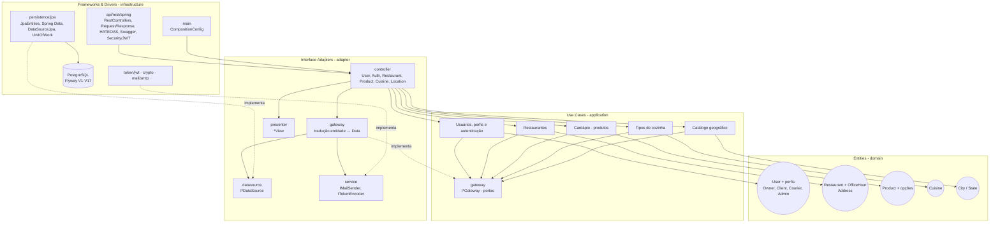
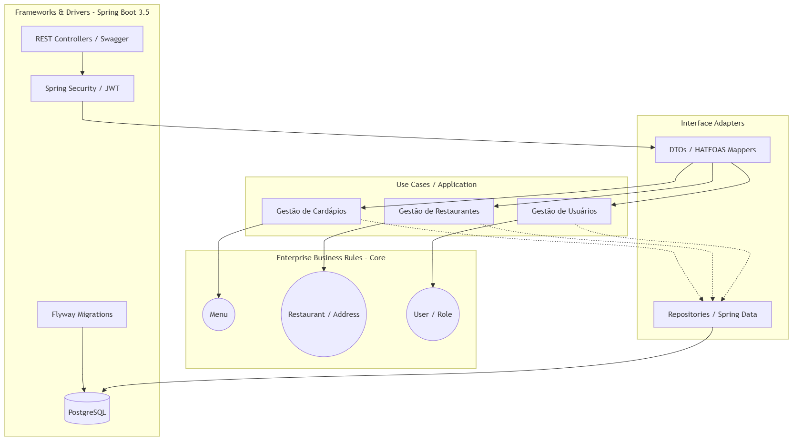

# Arquitetura Lógica - Tech Challenge Fase 2

Diagrama lógico do sistema no estado da Etapa 29: as quatro camadas da Clean Architecture, com a
dependência sempre apontando para dentro. As setas sólidas são dependências de código; as tracejadas,
implementação de interface (a porta é declarada por quem a consome). O detalhe de cada camada está em
[`docs/arquitetura/`](docs/arquitetura/README.md).

O papel do usuário é **derivado dos perfis** (não há mais `Role` nem catálogo de papéis desde a Etapa 21),
e o cardápio é o catálogo de **produtos** de cada restaurante (Etapa 27). Spring Data e JPA ficam em
`infrastructure`; o adaptador só conhece as interfaces `I*DataSource`.

## Visualização Estática (PNG)

A imagem abaixo é a primeira versão do diagrama (setembro de 2026, Etapa 16) e foi mantida como registro
histórico; o diagrama acima é o vigente.

