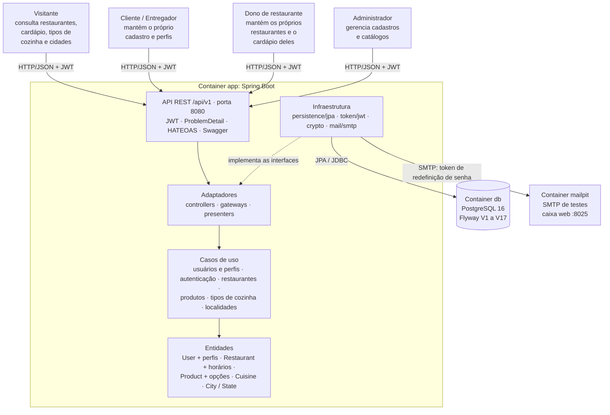
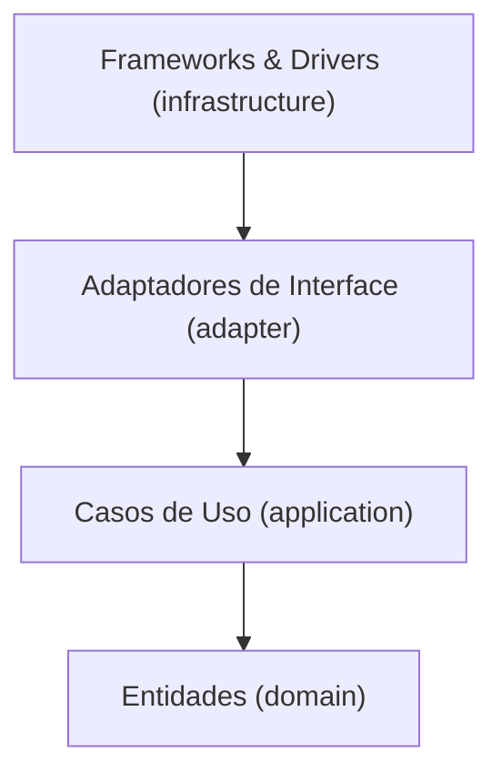

# Relatório Técnico Final — Tech Challenge Fase 2

## Sistema de Gestão de Restaurantes

**Grupo:**

| Integrante | RM |
| --- | --- |
| Felipe Dias Mac Dowell | `@rm375442` |
| Francisco Ferreira de Araujo | `@RM a preencher` |
| Rafael Brandão Silva | `@RM a preencher` |
| Rodrigo do Carmo Cruz | `@RM a preencher` |
| Ana Melissa | `@RM a preencher` |

- **Curso:** Pós-Tech — Arquitetura e Desenvolvimento Java
- **Repositório:** <https://github.com/felipe11dias/postech-fase2-restaurantes-app> (público)
- **Stack:** Java 21 · Spring Boot 3.5.11 · Spring Data JPA · PostgreSQL 16 · Flyway · Docker Compose
- **Arquitetura:** Clean Architecture (Robert C. Martin)
- **Versão do relatório:** final (Etapa 29), 28/10/2026 — código de referência: branch `etapa-29-revisao-final`

> Este é o documento de referência da entrega. Ele consolida as 29 etapas, a conformidade com o
> enunciado, a arquitetura e o roteiro do vídeo. As versões anteriores ficam em
> [`relatorios/`](./) como histórico detalhado — com os exemplos de código e as tabelas de cada etapa
> na época em que foi feita:
>
> | Versão | Escopo |
> | --- | --- |
> | [v1.0](relatorio-tech-challenge-fase02-v1.0.md) (também em PDF) | Etapas 1 a 15 e a primeira versão da 26 |
> | [v2.0](relatorio-tech-challenge-fase02-v2.0.md) (cabeçalho 2.2) | Etapas 1 a 25 e 27; Modelo de Dados v2 |
> | [v3.0](relatorio-tech-challenge-fase02-v3.0.md) | v2.0 + Etapa 26 completa |
> | [v4.0](relatorio-tech-challenge-fase02-v4.0.md) | Etapa 27 |
> | [v5.0](relatorio-tech-challenge-fase02-v5.0.md) | Etapa 28 |
>
> O [`CHANGELOG.md`](../CHANGELOG.md) registra, por etapa, o que mudou. A
> correlação entre aulas, autores de referência e código, camada por camada, está em
> [`docs/arquitetura/`](../docs/arquitetura/README.md).

---

## Sumário

1. [Sumário de progresso](#1-sumário-de-progresso)
2. [O problema e o escopo da Fase 2](#2-o-problema-e-o-escopo-da-fase-2)
3. [Conformidade com o enunciado](#3-conformidade-com-o-enunciado)
4. [Arquitetura](#4-arquitetura)
5. [As etapas](#5-as-etapas)
6. [Decisões técnicas](#6-decisões-técnicas)
7. [Desvios conscientes](#7-desvios-conscientes)
8. [Endpoints](#8-endpoints)
9. [Testes e cobertura](#9-testes-e-cobertura)
10. [Coleção Postman e prints](#10-coleção-postman-e-prints)
11. [Execução com Docker Compose](#11-execução-com-docker-compose)
12. [Vídeo de apresentação](#12-vídeo-de-apresentação)
13. [Referências bibliográficas](#13-referências-bibliográficas)

---

## 1. Sumário de progresso

**29 de 29 etapas concluídas.**

| # | Etapa | Status |
| --- | --- | --- |
| 1 | Setup do projeto e estrutura de pacotes | ✅ |
| 2 | Camada de entidades (domínio) | ✅ |
| 3 | Casos de uso e gateways | ✅ |
| 4 | Adaptadores de interface | ✅ |
| 5 | Persistência com JPA | ✅ |
| 6 | Migrations e seeds (Flyway) | ✅ |
| 7 | API REST, segurança e JWT | ✅ |
| 8 | Tratamento de erros (ProblemDetail) | ✅ |
| 9 | Documentação Swagger | ✅ |
| 10 | Execução com Docker Compose | ✅ |
| 11 | Testes unitários (100%) e de integração | ✅ |
| 12 | Entregáveis (Postman, README) | ✅ |
| 13 | Infraestrutura em módulos substituíveis | ✅ |
| 14 | Revisão de conformidade e documentação da arquitetura | ✅ |
| 15 | API REST em `api/rest/spring`, organizada como MVC | ✅ |
| 16 | Módulo de gestão de restaurantes | ✅ |
| 17 | Reorganização dos pacotes do agregado de usuário | ✅ |
| 18 | Endereços via `user_addresses` e endereço próprio do restaurante | ✅ |
| 19 | Token de redefinição único por usuário | ✅ |
| 20 | Perfis de usuário no domínio | ✅ |
| 21 | Usuário composto por perfis (papel derivado) | ✅ |
| 22 | Perfis em usuário existente e status do entregador | ✅ |
| 23 | Restaurante alinhado ao modelo v2 e à regra de posse | ✅ |
| 24 | Horário de funcionamento por dia | ✅ |
| 25 | Revisão de conformidade do modelo de dados v2 | ✅ |
| 26 | Endereços normalizados por cidade e estado | ✅ |
| 27 | Catálogo de produtos (itens do cardápio) | ✅ |
| 28 | Tipos de cozinha | ✅ |
| 29 | Revisão final da entrega | ✅ |

---

## 2. O problema e o escopo da Fase 2

Um grupo de restaurantes da região decidiu construir um sistema de gestão **único e compartilhado**,
em vez de manter sistemas individuais caros, para que o cliente escolha onde comer pela comida, não pela
qualidade do sistema. A entrega acontece em fases. A Fase 2 expande a base com:

- **tipos de usuário** — distinguir "Dono de Restaurante" e "Cliente" e associá-los a usuários existentes;
- **cadastro de restaurantes** — nome, endereço, tipo de cozinha, horário de funcionamento e dono;
- **cadastro dos itens do cardápio** — nome, descrição, preço, disponibilidade só no local e o caminho da
  foto do prato;
- requisitos técnicos: boas práticas do Spring Boot, documentação, Postman, Docker Compose, repositório
  aberto, Clean Architecture, testes unitários (80%) e de integração, e um vídeo de cerca de 5 minutos.

O projeto foi construído **do zero** sobre a Clean Architecture, sem herdar o código da Fase 1.

---

## 3. Conformidade com o enunciado

### Requisitos funcionais

| Requisito do enunciado | Status | Como o projeto atende | Evidência |
| --- | --- | --- | --- |
| Tipo de usuário: distinguir "Dono de Restaurante" e "Cliente" | ✅ | Perfis `owner` (dono), `client` (cliente), `courier` (entregador) e `admin` (administrador), cada um em tabela própria; o papel de autorização é derivado do perfil | `ProfileType`, `UserProfiles`; tabelas `owners`, `clients`, `couriers`, `admins` (V6) |
| Tipo de usuário: associar o tipo a usuários **existentes** | ✅ | `PUT /api/v1/users/{id}/profiles/{owner,client,courier,admin}` inclui ou altera; `DELETE …/profiles/{tipo}` remove; `GET /api/v1/users/{id}` mostra os perfis e papéis | `UserProfilesApiIT`; Postman, pasta 08 |
| Tipo de usuário: CRUD de tipos com "Nome do Tipo" | ✅ | O tipo é o perfil, com nome (`ProfileType`: dono, cliente, entregador, administrador), campos e regras próprios; o CRUD da associação com o usuário é feito em `/users/{id}/profiles/{tipo}` | [Como o requisito é atendido](#tipo-de-usuário-como-o-requisito-é-atendido) |
| Restaurante: CRUD completo | ✅ | `POST`, `GET` (por id e paginado com filtros), `PUT`, `DELETE` em `/api/v1/restaurants` | `RestaurantLifecycleIT`, `RestaurantOwnershipIT`; Postman, pastas 11 a 15 e 17 |
| Restaurante: nome, endereço, tipo de cozinha, horário, dono | ✅ | `name`; `address` com `cityId` do catálogo geográfico; `cuisineIds` do catálogo de tipos de cozinha; `officeHours` por dia da semana; `userId` (usuário com perfil de dono) | `CreateRestaurantRequest`, `RestaurantResponse`; V3, V8, V9, V11, V15 |
| Itens do cardápio: CRUD | ✅ | `POST`, `GET` (por id e paginado), `PUT`, `DELETE` em `/api/v1/restaurants/{restaurantId}/products` | `ProductCatalogIT`; Postman, pasta 16 |
| Itens do cardápio: nome, descrição, preço, só no local, foto | ✅ | `name`, `description`, `price` (`BigDecimal`/`numeric(10,2)`), `dineInOnly`, `imagePaths` (caminhos guardados como texto, sem upload, como o enunciado permite) | `ProductRequest`; V13, V14 |

### Tipo de usuário: como o requisito é atendido

**O que o enunciado pede.** Uma estrutura para distinguir "Dono de Restaurante" e "Cliente", um CRUD para
gerenciar tipos de usuário (campo "Nome do Tipo") e uma forma de associar o tipo a usuários existentes.

**O que o projeto faz.**

| Pedido do enunciado | No projeto |
| --- | --- |
| Distinguir dono e cliente | Cada tipo é um **perfil** com tabela própria — `owners` (CNPJ, razão social, telefone comercial), `clients` (CPF, telefone, nascimento), `couriers` (CPF, veículo, CNH, placa, status) e `admins` (código de funcionário, departamento) — ligada a `users` por chave primária = estrangeira (V6) |
| "Nome do Tipo" | `ProfileType`: `OWNER` "dono", `CLIENT` "cliente", `COURIER` "entregador", `ADMIN` "administrador"; o nome aparece nas mensagens e o papel (`ROLE_OWNER`…) é derivado do perfil |
| Associar o tipo a um usuário existente (criar/alterar) | `PUT /api/v1/users/{id}/profiles/{owner,client,courier,admin}` |
| Consultar os tipos de um usuário | `GET /api/v1/users/{id}` (perfis e `roles` na resposta) |
| Desassociar | `DELETE /api/v1/users/{id}/profiles/{tipo}` (não o último perfil; não o de dono com restaurante; não o do último administrador) |
| Distinguir na prática | `@PreAuthorize` por papel: só quem tem perfil de dono cadastra restaurante; só administrador mantém o catálogo de tipos de cozinha |

Os tipos são gerenciados pela API como **perfis**: cada um tem nome, campos e regras próprios, e a associação
ao usuário existente é um CRUD completo (incluir, consultar, alterar e remover). O que o projeto não oferece é
um tipo novo criado em tempo de execução só com um nome (`POST /user-types`), pelos motivos abaixo.

**Por que o tipo é um perfil, e não uma tabela só de nomes.** As referências que guiam o projeto apontam
todas para o mesmo lado:

1. **O tipo de usuário tem atributos e regras próprios.** O dono tem CNPJ; o cliente, CPF e nascimento não
   futuro; o entregador, CNH e placa conforme o veículo; o administrador, código de funcionário. No modelo
   relacional isso é **generalização/especialização**, que se implementa com uma tabela por subtipo (Date;
   Machado). Uma tabela `user_types` só com nome não carrega esses campos nem as restrições deles (o
   `CHECK` de CNH por veículo, o gatilho "um CPF, uma pessoa"). Um tipo novo criado por ela seria um rótulo
   sem dados nem comportamento.
2. **O tipo decide autorização.** As regras de acesso (`ROLE_OWNER` cadastra restaurante, `ROLE_ADMIN`
   mantém catálogos) estão no código. Se o tipo fosse um registro editável, renomear ou excluir "Dono"
   quebraria uma regra de segurança sem que o compilador ou os testes percebessem. Regra crítica de
   negócio mora na entidade, não num dado (Martin, *Clean Architecture*, cap. 20). Acrescentar um tipo é
   mudança de código verificada pelo compilador: a entrada `UserProfileDTO` é uma interface selada, e o
   `switch` do `SaveUserProfileUseCase` exige um `case` por tipo (OCP aplicado a um conjunto fechado).
3. **O Modelo de Dados v2, adotado pelo grupo, fixa os tipos no schema** (`owners`, `clients`, `couriers`,
   `admins`). O conflito com o "CRUD de tipos" foi registrado no planejamento da Etapa 17 e decidido na 21.
4. **O mesmo critério vale no resto do projeto.** O tipo de cozinha **é** um catálogo editável (Etapa 28)
   porque não carrega comportamento nem campos — é um rótulo que o restaurante referencia. O tipo de
   usuário carrega os dois. A diferença entre os dois catálogos é a aplicação de uma regra só.

**Resultado.** Distinguir os tipos, dar nome a eles e gerenciar a associação com usuários existentes
(incluir, consultar, alterar e remover) estão atendidos e testados (`UserProfilesApiIT`, pasta 08 da
coleção). Um tipo novo exige dizer quais campos e regras ele tem — por isso entra como código, verificado
pelo compilador, e não como um registro.

### Entregáveis e fatores de avaliação

| Fator | Status | Evidência |
| --- | --- | --- |
| 1. Funcionalidade: endpoints funcionando | ✅ | 32 operações REST; coleção Postman com 187 requests e 389 asserções, sem falhas, em duas execuções seguidas (seção 10) |
| 2. Qualidade do código: práticas do Spring Boot, código organizado e documentado | ✅ | Spring Boot 3.5 com Security, Data JPA, Validation, HATEOAS, Actuator, springdoc; `package-info` em cada pacote; Swagger UI; regras de organização verificadas no build |
| 3. Documentação: arquitetura, endpoints, configuração e execução | ✅ | [`README.md`](../README.md), este relatório, Swagger em `/swagger-ui.html`, [`docs/arquitetura/`](../docs/arquitetura/README.md), [`docs/modelo-dados/`](../docs/modelo-dados/README.md), [`arquitetura-logica.md`](../arquitetura-logica.md) |
| 4. Collections para teste | ✅ | [`postman/Restaurantes.postman_collection.json`](../postman/Restaurantes.postman_collection.json): um request por retorno documentado de cada endpoint, com um print por request |
| 5. Docker Compose com aplicação e banco | ✅ | [`docker-compose.yml`](../docker-compose.yml): aplicação, PostgreSQL 16.15 e Mailpit, com healthchecks |
| 6. Repositório aberto | ✅ | GitHub público, com histórico por etapa |
| 7. Clean Architecture em camadas | ✅ | `domain`, `application`, `adapter`, `infrastructure`; 48 regras ArchUnit falham o build se a regra de dependência for violada |
| 8. Cobertura: unitários ≥ 80% e testes de integração | ✅ | 939 testes unitários com **100%** de linhas e ramos (gate do JaCoCo); 164 testes de integração com PostgreSQL real (Testcontainers) |
| 9. Vídeo de ~5 minutos | ⏳ a gravar | Roteiro pronto na [seção 12](#12-vídeo-de-apresentação) |

---

## 4. Arquitetura

### Diagrama do sistema



Os quatro tipos de usuário acessam a mesma API REST (pelo Postman, pelo Swagger UI ou por qualquer cliente HTTP), e a autorização decide o que cada um pode fazer: o
visitante só consulta; o cliente e o entregador mantêm o próprio cadastro; o dono, os próprios restaurantes
e o cardápio deles; o administrador, todos os cadastros e os catálogos (tipos de cozinha). Dentro da
aplicação, a requisição atravessa as camadas de fora para dentro, e a infraestrutura — banco, token, hash e
e-mail — só é alcançada pelas interfaces que o núcleo e os adaptadores declaram. O Compose sobe a aplicação,
o PostgreSQL e o Mailpit, que recebe os e-mails de recuperação de senha.

### As quatro camadas



| Camada | Pacote | O que contém |
| --- | --- | --- |
| Entidades | `domain` | `User` e os perfis, `Address`, `City`, `State`, `PasswordResetToken`, `Restaurant` e `OfficeHour`, `Cuisine`, `Product` e as opções; VOs (`Email`, `ZipCode`, `Cpf`, `Cnpj`, `Phone`, `LicensePlate`, `DriverLicense`); exceções de negócio; `Guard`. Só JDK |
| Casos de Uso | `application` | 31 casos de uso (`create` + `run`) em seis features (`user`, `auth`, `restaurant`, `product`, `cuisine`, `location`), políticas compartilhadas (`*Policy`), portas `I*Gateway` e DTOs. Só `domain` |
| Adaptadores de Interface | `adapter` | controllers (orquestram), gateways (traduzem entidade ↔ registro), interfaces de origem de dados e de serviço, presenters e views |
| Frameworks & Drivers | `infrastructure` | módulos substituíveis: `main` (composição), `api/rest/spring` (API REST em MVC), `persistence/jpa`, `token/jwt`, `crypto`, `mail/smtp` — o único lugar com Spring, JPA, jjwt e Jakarta |

### Fluxo de uma requisição

`@RestController` (infraestrutura) → controller de adaptação → cria o gateway sobre a origem de dados e o
caso de uso → `unitOfWork.execute(() -> useCase.run(dto))` → entidades do domínio → gateway traduz a
entidade em registro → `*DataSourceJpa` → `JpaRepository` → volta → presenter monta a view →
`@RestController` monta a resposta com links HATEOAS.

### Como o build garante a arquitetura

| Suíte | Regras | O que verifica |
| --- | --- | --- |
| `ArchitectureTest` | 17 | regra de dependência entre as quatro camadas; sufixos e prefixos (`*UseCase`, `I*Gateway`, `*Data`, `*View`, `*Policy`); VOs como `record`; registros sem tipo do domínio |
| `InfrastructureModulesTest` | 24 | nenhum ciclo entre pacotes; módulos que não se conhecem; cada biblioteca só no seu módulo; a infraestrutura só conhece as portas técnicas e as exceções do domínio; organização MVC da API |
| `TestConventionsTest` | 7 | `@DisplayName`, nomes `should…`, unitário sem Spring nem banco, integração pelas bases, dublê só do SMTP |

Detalhe de cada camada — o que as aulas ensinam, o que os autores dizem, como o projeto faz e quais
desvios são conscientes — em [`docs/arquitetura/`](../docs/arquitetura/README.md); diagrama lógico em
[`arquitetura-logica.md`](../arquitetura-logica.md); modelo de dados e divergências do schema físico em
[`docs/modelo-dados/`](../docs/modelo-dados/README.md).

---

## 5. As etapas

Cada etapa abaixo traz o objetivo, o que foi entregue com o **conceito** que sustenta cada decisão, o
resultado do build na época. O detalhe completo (exemplos de código, tabelas, revisão de
código) está na seção homônima do relatório histórico indicado.

### Etapa 1 — Setup do projeto e estrutura de pacotes
*Detalhe: relatório v2.0*

- **Objetivo:** projeto Maven com Spring Boot 3.5 e Java 21 e a estrutura de pacotes da Clean Architecture.
- **Entregue:** pacotes `domain`, `application`, `adapter`, `infrastructure`, cada um com `package-info`
  dizendo sua regra (*Clean Architecture*, cap. 22: a regra de dependência); `ArchitectureTest` ativo desde
  o primeiro commit (a arquitetura é verificada, não só desenhada); JaCoCo exigindo 100%; Dockerfile e
  Compose iniciais. Sem Lombok nem geração de código no núcleo (*Clean Code*: o código diz o que faz).

### Etapa 2 — Camada de entidades
*Detalhe: relatório v2.0*

- **Objetivo:** as regras de negócio que valem sempre.
- **Entregue:** `Guard`, VOs `Email` e `ZipCode` como `record`, `User` com `create`/`restore`,
  `PasswordResetToken` com o instante por parâmetro, `DomainException` e subclasses. Toda instância passa
  por validação (Martin: entidades guardam as regras críticas; *Clean Code* cap. 7: exceções com
  significado).
- **Resultado:** 111 testes sem mocks; 100% de cobertura do domínio.

### Etapa 3 — Casos de uso e gateways
*Detalhe: relatório v2.0*

- **Objetivo:** uma intenção do ator por classe (Cockburn).
- **Entregue:** nove casos de uso com `create`/`run`, portas em `application/gateway`, paginação própria
  (`PageRequest`/`PageResult`). Login inexistente e senha errada respondem com a mesma mensagem e o mesmo
  tempo (`IPasswordEncoder.simulateMatch`): o algoritmo de hash não entra no núcleo (DIP). Pacotes por
  feature (*screaming architecture*).
- **Resultado:** 78 testes novos com Mockito e `Clock.fixed`.

### Etapa 4 — Adaptadores de interface
*Detalhe: relatório v2.0*

- **Entregue:** controllers que orquestram (criam gateway e caso de uso a cada operação), gateways que
  traduzem entidade ↔ registro, presenters e views sem campo de senha; porta `IUnitOfWork` (o caso de uso
  não sabe que transação existe). Conceito: *Adapter* (Freeman) e a fronteira de dados de Martin (cap. 23).
- **Resultado:** 45 testes novos; 100%.

### Etapa 5 — Persistência com JPA
*Detalhe: relatório v2.0*

- **Entregue:** entidades JPA separadas das de domínio (duas fronteiras de mapeamento: nenhuma anotação
  atravessa para dentro), origens de dados `*DataSourceJpa`, busca paginada em duas consultas (sem
  paginação em memória), ordenação traduzida por mapa, `TransactionalUnitOfWork`.
- **Resultado:** 290 testes unitários; 100%.

### Etapa 6 — Migrations e seeds
*Detalhe: relatório v2.0*

- **Entregue:** V1 (schema) e V2 (usuários de demonstração); JPA só valida (`ddl-auto: validate`); primeiros
  testes de integração sobre PostgreSQL real, com container único compartilhado. Conceito: o banco é um
  detalhe, mas o schema é versionado (Date: integridade declarada no banco).
- **Resultado:** 290 unitários e 27 de integração.

### Etapa 7 — API REST, segurança e JWT
*Detalhe: relatório v2.0*

- **Entregue:** controllers REST com HATEOAS, autenticação stateless com JWT, BCrypt, autorização por
  posse (`@userSecurity.isSelf`) contra IDOR, listagem só do administrador, `JWT_SECRET` obrigatório,
  recuperação de senha que não revela quem tem conta.
- **Resultado:** 363 unitários e 50 de integração.

### Etapa 8 — Tratamento de erros
*Detalhe: relatório v2.0*

- **Entregue:** `GlobalExceptionHandler` único, `ProblemDetail` (RFC 9457) com `type` estável por
  categoria; só mensagem escrita para o usuário vai ao `detail`. Conceito: o núcleo não sabe que HTTP
  existe; a tradução é da borda.
- **Resultado:** 389 unitários e 64 de integração.

### Etapa 9 — Documentação Swagger
*Detalhe: relatório v2.0*

- **Entregue:** OpenAPI com `@ErrorResponse(type = ProblemType.X)` — o status documentado sai do mesmo
  catálogo do handler; `OpenApiDocumentationIT` confronta documento e aplicação (cadeado, exemplos).
- **Resultado:** 411 unitários e 73 de integração.

### Etapa 10 — Docker Compose
*Detalhe: relatório v2.0*

- **Entregue:** aplicação, PostgreSQL e Mailpit; imagens com versão exata; portas só em `127.0.0.1`;
  usuário sem privilégio; healthcheck que não depende do SMTP.
- **Resultado:** 411 unitários e 76 de integração; passo a passo executado literalmente.

### Etapa 11 — Testes
*Detalhe: relatório v2.0*

- **Entregue:** gate de cobertura medindo só os unitários; ITs de JWT, busca e ciclo de vida;
  `TestConventionsTest`; suíte em ordem aleatória. Conceito: F.I.R.S.T. e a pirâmide de testes (*Clean
  Coder*, cap. 8).
- **Resultado:** 422 unitários e 89 de integração; 100%.

### Etapa 12 — Entregáveis
*Detalhe: relatório v2.0*

- **Entregue:** coleção Postman com um request por caso, testes de status e `type`, prints gerados da
  execução do Newman, README reescrito.
- **Resultado:** 52 requests, 108 asserções, sem falhas, em duas execuções.

### Etapa 13 — Infraestrutura em módulos substituíveis
*Detalhe: relatório v2.0*

- **Entregue:** `infrastructure` por papel/tecnologia; módulos que não se conhecem, ligados só pelo `main`
  (Main, cap. 26); `InfrastructureModulesTest` (ADP: nenhum ciclo).
- **Resultado:** 441 unitários e 89 de integração.

### Etapa 14 — Revisão de conformidade e documentação da arquitetura
*Detalhe: relatório v2.0*

- **Entregue:** gateways de serviço (e-mail e token traduzidos no adaptador, a infraestrutura só
  transporta); "esqueci minha senha" com o mesmo tempo de resposta (fila própria) e e-mail só depois do
  commit; `docs/arquitetura/` por camada.
- **Resultado:** 458 unitários e 91 de integração.

### Etapa 15 — API REST organizada como MVC
*Detalhe: relatório v2.0*

- **Entregue:** `infrastructure/api/rest/spring` com um pacote por papel da classe, caminhos em
  `route/ApiRoutes`, sete regras ArchUnit novas. Desvio consciente: na API o pacote é por papel, não por
  feature (registrado em `docs/arquitetura/04`).
- **Resultado:** 465 unitários e 91 de integração.

### Etapa 16 — Módulo de gestão de restaurantes
*Detalhe: relatório v2.0 e [relatório do módulo](../docs/relatorio-academico-modulo-restaurantes.md)*

- **Objetivo:** primeira versão do CRUD de restaurantes.
- **Entregue:** V3 (`restaurants`), entidade `Restaurant`, os cinco casos de uso, adaptadores, API em
  `/api/v1/restaurants`, `RestaurantLifecycleIT`, diagrama lógico do sistema e a coleção de restaurantes
  com 67 prints. A estrutura seguiu a vertical das quatro camadas (*screaming architecture*).
- **O que mudou depois:** a Etapa 17 completou a cobertura de ramos e atualizou os ITs de schema e de
  documentação; as Etapas 18, 21, 23 e 24 reescreveram endereço, dono, posse e horário.

### Etapa 17 — Reorganização dos pacotes do agregado de usuário
*Detalhe: relatório v2.0*

- **Entregue:** o Modelo de Dados v2 entra no repositório (`docs/modelo-dados/`) e as Etapas 17 a 25 são
  planejadas; partes do agregado de usuário em subpacotes, ligadas só do lado da raiz (sem ciclo de
  pacotes, ADP).
- **Resultado:** 530 unitários e 92 de integração; Newman 67 requests.

### Etapa 18 — Endereços via `user_addresses`
*Detalhe: relatório v2.0*

- **Entregue:** V4; usuário com vários endereços, exatamente um padrão (restrição adiada para o commit);
  restaurante com endereço próprio; tradução do endereço numa classe só (`AddressMapping`, duplicação
  verdadeira, Martin cap. 16).
- **Resultado:** 560 unitários e 98 de integração.

### Etapa 19 — Token de redefinição único por usuário
*Detalhe: relatório v2.0*

- **Entregue:** V5 (`UNIQUE (user_id)`); o pedido novo reemite o token e invalida o link anterior.
- **Resultado:** 565 unitários e 101 de integração.

### Etapa 20 — Perfis de usuário no domínio
*Detalhe: relatório v2.0*

- **Entregue:** VOs `Cpf`, `Cnpj` (inclusive alfanumérico), `Phone`, `LicensePlate`, `DriverLicense`; perfis
  `OwnerProfile`, `ClientProfile`, `CourierProfile`, `AdminProfile` (especializações do modelo v2).
- **Resultado:** 662 unitários.

### Etapa 21 — Usuário composto por perfis
*Detalhe: relatório v2.0*

- **Entregue:** V6 (tabelas `owners`, `clients`, `couriers`, `admins`; saem `roles` e `user_roles`);
  `UserProfiles` com ao menos um perfil e o mesmo CPF entre cliente e entregador; papel derivado do perfil.
  Conceito: generalização/especialização total e sobreposta (Date, Machado).
- **Resultado:** 680 unitários e 114 de integração; Newman 76 requests.

### Etapa 22 — Perfis em usuário existente
*Detalhe: relatório v2.0*

- **Entregue:** incluir, alterar e remover perfil (`/users/{id}/profiles/…`) e status do entregador; papéis
  lidos do cadastro a cada requisição; `ResourceInUseException` (409); regra de documentos únicos numa
  política (`UniqueDocumentsPolicy`); V7 com garantias no schema para o que duas requisições simultâneas
  poderiam furar.
- **Resultado:** 740 unitários e 125 de integração; Newman 113 requests.

### Etapa 23 — Restaurante e regra de posse
*Detalhe: relatório v2.0*

- **Entregue:** `@restaurantSecurity.isOwner` pela porta `IRestaurantOwnerReader`; o dono cuida só dos
  próprios restaurantes; indicar outro dono é do administrador; excluir o usuário exclui os restaurantes
  dele (V8).
- **Resultado:** 751 unitários e 132 de integração; Newman 123 requests.

### Etapa 24 — Horário de funcionamento por dia
*Detalhe: relatório v2.0*

- **Entregue:** V9 (`restaurant_office_hours`); `OfficeHour` como valor, com expediente que vira a meia-noite
  e sobreposição conferida na semana circular.
- **Resultado:** 766 unitários e 136 de integração; Newman 124 requests.

### Etapa 25 — Revisão de conformidade do modelo de dados v2
*Detalhe: relatório v2.0*

- **Entregue:** quadro "modelo v2 × schema real" tabela por tabela; o último administrador não sai (V10,
  `LastAdminPolicy`); quatro regras ArchUnit novas.
- **Resultado:** 775 unitários e 138 de integração; Newman 125 requests; suíte em ordem aleatória.

### Etapa 26 — Endereços normalizados por cidade e estado
*Detalhe: relatório v3.0*

- **Objetivo:** endereço ligado a uma cidade de um catálogo, em vez de texto livre.
- **Entregue:** `City` e `State` no domínio e na JPA; `cityId` obrigatório no endereço de usuário e de
  restaurante; V11 (normalização preservando ids e vínculos de um banco na V10) e V12 (27 UFs, capitais e
  Campinas); `GET /api/v1/states` e `GET /api/v1/cities` públicos e só de leitura; tradução compartilhada
  (`LocationMapping`) e validações movidas para os presenters. Conceito: normalização e integridade
  referencial (Date) sem acoplar o domínio à JPA.
- **Resultado:** 734 unitários e 142 de integração; 11 prints dos cenários de endereço.

### Etapa 27 — Catálogo de produtos (itens do cardápio)
*Detalhe: relatório v2.0 e v4.0*

- **Objetivo:** o CRUD de itens do cardápio do enunciado.
- **Entregue:** agregado `Product` com imagens (caminhos/URLs como texto), grupos e valores de opção;
  `dineInOnly`; API aninhada em `/api/v1/restaurants/{restaurantId}/products` com leitura pública e
  escrita pelo dono ou administrador; V13 e V14 (preço `numeric(10,2)`/`BigDecimal`, sem aproximação
  binária em dinheiro); paginação em duas consultas.
- **Resultado:** 851 unitários (100%); `ProductCatalogIT`; 20 requests e 20 prints.

### Etapa 28 — Tipos de cozinha
*Detalhe: relatório v5.0*

- **Objetivo:** o "tipo de cozinha" do cadastro de restaurante.
- **Entregue:** agregado `Cuisine` (catálogo com leitura pública e escrita do administrador); restaurante
  com `cuisineIds` e filtro `?cuisineId=` na listagem; V15 (catálogo e ligação N:N com `RESTRICT` no tipo),
  V16 (oito tipos iniciais), V17 (ordenação pela regra do português); políticas
  `UniqueCuisineNamePolicy` e `ExistingCuisinesPolicy`; tipo em uso não sai (409). O merge com a `main`
  renumerou as migrations (V11/V12 → V15/V16) e corrigiu a porta interna do Compose.
- **Resultado:** 939 unitários e 164 de integração; 100%; 169 requests e 343 asserções.

### Etapa 29 — Revisão final da entrega
- **Objetivo:** fechar a entrega contra o enunciado e consolidar a documentação.
- **Entregue:**
  - **Coleção Postman:** auditoria de todos os retornos de cada endpoint contra as `@ErrorResponse` e
    as recusas implícitas (401 sem token, 400 de id que não é UUID, 404 que só o administrador alcança);
    18 requests novos, conferência do `type` em 10 requests que só conferiam o status, pasta do catálogo
    geográfico em português e numeração refeita pela posição de execução (havia 126 a 130 repetidos).
    Prints regenerados.
  - **Documentação OpenAPI:** o 400 de id que não é UUID declarado nos quatro `DELETE`, e o 400 da listagem
    de restaurantes cobrindo `ownerId`/`cuisineId` inválidos — o documento passa a dizer tudo o que a API
    responde (conceito da Etapa 9: documentação e resposta não podem divergir).
  - **CHANGELOG** reorganizado por etapa (1 → 29); contradições removidas.
  - **README, `docs/arquitetura/`, `docs/modelo-dados/`, `arquitetura-logica.md`** sincronizados com o
    código; relatório da Etapa 16 marcado como histórico.
  - **Este relatório final**, com a conformidade, a forma como o tipo de usuário é atendido, o diagrama do
    sistema e o roteiro do vídeo.
- **Resultado:** 939 unitários e 164 de integração, cobertura unitária de 100% (2.766 linhas e
  626 ramos); Newman com 187 requests e 389 asserções, sem falhas, em duas execuções.

---

## 6. Decisões técnicas

| Decisão | Conceito | Etapa |
| --- | --- | --- |
| Quatro camadas concêntricas, dependência só para dentro, verificada por ArchUnit | Regra de dependência (Martin, cap. 22) | 1, 11 |
| Entidades validam os próprios invariantes (`create`/`restore`, setters que revalidam) | Entidades guardam as regras críticas (Martin, cap. 20) | 2 |
| Um caso de uso por intenção do ator, dependendo só de portas | Casos de uso (Cockburn; Martin, cap. 20); DIP | 3 |
| Controller orquestra, gateway traduz, presenter decide o que sai | *Adapter* (Freeman); fronteiras (Martin, cap. 23) | 4, 14 |
| Entidades JPA e DTOs HTTP separados do núcleo | Banco e web são detalhes (Martin, cap. 30–31) | 5, 7 |
| Schema versionado pelo Flyway; o JPA só valida | Integridade declarada no banco (Date) | 6 |
| JWT stateless, BCrypt, autorização por posse | Segurança na borda; IDOR | 7, 23 |
| Erros em ProblemDetail, traduzidos num lugar só | O núcleo não conhece HTTP | 8 |
| Documentação de erro pela categoria, conferida por IT | Documentação e resposta não divergem | 9, 29 |
| Infraestrutura em módulos substituíveis, sem ciclos | Plugin (Martin, cap. 17); ADP; Main (cap. 26) | 13 |
| Tipo de usuário por especialização (perfis), papel derivado | Generalização/especialização (Date, Machado) | 20–22 |
| Regra que duas requisições podem furar ganha garantia no schema | Integridade no SGBD (Date) | 18, 22, 25, 28 |
| Endereço ligado a cidade de um catálogo | Normalização (Date) | 26 |
| Preço em `BigDecimal`/`numeric(10,2)` | Valor monetário sem aproximação binária | 27 |
| Tipo de cozinha como catálogo editável; política de nome único | Regra de aplicação que consulta outros agregados vai para `*Policy` | 28 |
| Testes em dois níveis: 100% unitário e integração com componentes reais | F.I.R.S.T.; pirâmide (*Clean Coder*, cap. 8) | 11 |

---

## 7. Desvios conscientes

| Ponto | No modelo ou no enunciado | No projeto | Por quê |
| --- | --- | --- | --- |
| Foto do prato | `images.content` `blob` no modelo | `varchar(2048)` com o caminho/URL | o enunciado diz que a foto não será usada e basta salvar o caminho |
| Preço do produto | `double` no modelo | `numeric(10,2)` e `BigDecimal` (V14) | dinheiro sem aproximação binária |
| Tipo de cozinha no restaurante | campo do cadastro | `cuisineIds` opcional no `POST` (ausente = nenhum) | o catálogo é mantido pelo administrador; um restaurante pode ser cadastrado antes de o tipo existir no catálogo e ganhar o tipo no `PUT` |
| Cidades e estados | — | só leitura pela API; carga por migration | catálogo de referência; o enunciado não pede CRUD |
| Pacotes da API | *screaming architecture* | por papel da classe em `api/rest/spring` | a API é um detalhe de entrega organizado como MVC (Etapa 15) |
| Portas técnicas | todo acesso externo por gateway do adaptador | `IPasswordEncoder`, `ISecureTokenGenerator`, `IUnitOfWork` implementadas direto pela infraestrutura | não há tradução a fazer; "havendo tradução, há gateway" (Etapa 14) |

As divergências entre o modelo lógico e o schema físico, tabela por tabela, estão em
[`docs/modelo-dados/README.md`](../docs/modelo-dados/README.md).

---

## 8. Endpoints

Todos em `/api/v1`. Documentação interativa, com exemplos de cada resposta, em `/swagger-ui.html`.

| Método | Rota | Acesso | Sucesso | Erros documentados |
| --- | --- | --- | --- | --- |
| `POST` | `/auth/login` | público | 200 | 400, 401 |
| `POST` | `/auth/forgot-password` | público | 202 | 400 |
| `POST` | `/auth/reset-password` | público | 204 | 400 (`requisicao-invalida`, `senha-invalida`, `token-invalido`) |
| `POST` | `/users` | público | 201 | 400, 404 (cidade), 409 |
| `GET` | `/users` | administrador | 200 | 400, 401, 403 |
| `GET` | `/users/{id}` | o próprio ou administrador | 200 | 400, 401, 403, 404 |
| `PUT` | `/users/{id}` | o próprio ou administrador | 200 | 400, 401, 403, 404, 409 |
| `PATCH` | `/users/{id}/password` | o próprio ou administrador | 204 | 400, 401, 403, 404 |
| `DELETE` | `/users/{id}` | o próprio ou administrador | 204 | 400, 401, 403, 404, 409 (último administrador) |
| `PUT` | `/users/{id}/profiles/{owner,client,courier}` | o próprio ou administrador | 200 | 400, 401, 403, 404, 409 |
| `PUT` | `/users/{id}/profiles/admin` | administrador | 200 | 400, 401, 403, 404, 409 |
| `DELETE` | `/users/{id}/profiles/{tipo}` | o próprio ou administrador | 204 | 400, 401, 403, 404, 409 |
| `PATCH` | `/users/{id}/profiles/courier/status` | o próprio ou administrador | 200 | 400, 401, 403, 404 |
| `POST` | `/restaurants` | dono (para si) ou administrador | 201 | 400, 401, 403, 404 |
| `GET` | `/restaurants?name=&ownerId=&cuisineId=` | público | 200 | 400 |
| `GET` | `/restaurants/{id}` | público | 200 | 400, 404 |
| `PUT` | `/restaurants/{id}` | dono do restaurante ou administrador | 200 | 400, 401, 403, 404 |
| `DELETE` | `/restaurants/{id}` | dono do restaurante ou administrador | 204 | 400, 401, 403, 404 |
| `POST` | `/restaurants/{rid}/products` | dono do restaurante ou administrador | 201 | 400, 401, 403, 404 |
| `GET` | `/restaurants/{rid}/products` | público | 200 | 400, 404 |
| `GET` | `/restaurants/{rid}/products/{pid}` | público | 200 | 400, 404 |
| `PUT` | `/restaurants/{rid}/products/{pid}` | dono do restaurante ou administrador | 200 | 400, 401, 403, 404 |
| `DELETE` | `/restaurants/{rid}/products/{pid}` | dono do restaurante ou administrador | 204 | 400, 401, 403, 404 |
| `POST` | `/cuisines` | administrador | 201 | 400, 401, 403, 409 |
| `GET` | `/cuisines?name=` | público | 200 | 400 |
| `GET` | `/cuisines/{id}` | público | 200 | 400, 404 |
| `PUT` | `/cuisines/{id}` | administrador | 200 | 400, 401, 403, 404, 409 |
| `DELETE` | `/cuisines/{id}` | administrador | 204 | 400, 401, 403, 404, 409 (em uso) |
| `GET` | `/states` | público | 200 | — |
| `GET` | `/cities?stateId=&name=` | público | 200 | 400 |

O `type` de cada erro (`urn:restaurantes:problema:…`) e o significado de cada categoria estão no
[README](../README.md#endpoints).

---

## 9. Testes e cobertura

| Nível | Quantidade | Como |
| --- | --- | --- |
| Unitários | 939 | entidades sem mocks; casos de uso com mocks das portas; adaptadores com mocks das origens de dados; nenhum sobe Spring nem toca banco |
| Arquitetura | 48 regras | ArchUnit (`ArchitectureTest`, `InfrastructureModulesTest`, `TestConventionsTest`) |
| Integração | 164 | `@SpringBootTest`, PostgreSQL real (Testcontainers), Flyway, JWT ativo, HTTP de verdade; só o SMTP é dublê |
| Aceitação | 187 requests | coleção Postman rodada com Newman contra a pilha do Compose |

- **Cobertura unitária: 100% de linhas e ramos** (2.766 linhas, 626 ramos) — o build falha
  abaixo disso. O enunciado pede 80%.
- O gate mede **só** os testes unitários; a integração tem relatório próprio, informativo
  (`target/site/jacoco-it`).
- A suíte roda em ordem aleatória sem falhas: cada teste cria os próprios dados com marca única.

Comandos: `mvn test` (unitários e ArchUnit, sem Docker) e `mvn verify` (tudo, com Docker).

---

## 10. Coleção Postman e prints

[`postman/Restaurantes.postman_collection.json`](../postman/Restaurantes.postman_collection.json) tem
**187 requests em 19 pastas**, um por retorno documentado de cada endpoint — o sucesso e cada erro —, na
ordem em que rodam. Cada teste confere o status e, nos erros, o `type` do ProblemDetail.

- **Execução da Etapa 29:** 187 requests, 389 asserções, nenhuma falha, em **duas execuções
  seguidas** contra o mesmo banco (a coleção cria e exclui os próprios dados; CPF, CNPJ e CNH são gerados
  a cada request).
- **Auditoria da Etapa 29:** cada `@ErrorResponse` de cada operação tem um request; entraram os retornos
  que faltavam (400 de id inválido e de paginação, 401 e 403 do catálogo de cozinhas, 404 que só o
  administrador alcança no restaurante). O 500 (`erro-inesperado`) não tem request: não há como provocá-lo
  pela API sem quebrar a aplicação de propósito.
- **Prints:** [`postman/prints/`](../postman/prints/), um por request, com o número do request no nome do
  arquivo, gerados da segunda execução por `postman/gerar-prints.js`.

```bash
npx newman@6 run postman/Restaurantes.postman_collection.json --reporters cli,json --reporter-json-export target/newman.json
node postman/gerar-prints.js target/newman.json postman/Restaurantes.postman_collection.json postman/prints
```

---

## 11. Execução com Docker Compose

```bash
cp .env.example .env            # e cole em JWT_SECRET um segredo próprio: openssl rand -base64 48
docker compose up --build       # aplicação, PostgreSQL e Mailpit
```

| O quê | Endereço |
| --- | --- |
| API | `http://localhost:8080/api/v1` |
| Swagger UI | `http://localhost:8080/swagger-ui.html` |
| Saúde | `http://localhost:8080/actuator/health` |
| E-mails (Mailpit) | `http://localhost:8025` |

Usuários de demonstração: `admin.demo` / `admin12345`, `dono.restaurante` / `dono12345`,
`cliente.demo` / `cliente12345`. Execução fora do Docker, variáveis e portas: [README](../README.md).

---

## 12. Vídeo de apresentação

**Status:** a gravar. **Link:** `[a inserir]`

Roteiro de cerca de 5 minutos, com a pilha no ar (`docker compose up --build`) e o Swagger aberto:

| Tempo | O que mostrar | Onde |
| --- | --- | --- |
| 0:00–0:30 | O problema e o grupo; o repositório no GitHub | README |
| 0:30–1:15 | A arquitetura: as quatro camadas, a regra de dependência e as 48 regras ArchUnit; `mvn test` passando | `arquitetura-logica.md`, terminal |
| 1:15–1:45 | `docker compose up` e a saúde da aplicação; Swagger UI | navegador |
| 1:45–2:30 | Tipos de usuário: autocadastro de cliente; inclusão do perfil de dono no mesmo usuário (`PUT /users/{id}/profiles/owner`); login do dono | Postman, pastas 02 e 08 |
| 2:30–3:30 | Restaurante: cadastro pelo dono com endereço (`cityId`), horários por dia e tipo de cozinha; listagem pública filtrada por tipo; outro dono recebe 403 ao tentar alterar | Postman, pastas 12, 15 e 19 |
| 3:30–4:20 | Cardápio: cadastro de produto com preço, `dineInOnly` e `imagePaths`; consulta pública; exclusão | Postman, pasta 16 |
| 4:20–4:45 | A coleção inteira no Newman: 187 requests, zero falhas | terminal |
| 4:45–5:00 | Testes: `mvn verify` e o relatório do JaCoCo com 100% | navegador |

---

## 13. Referências bibliográficas

**Arquitetura e código**

- MARTIN, R. *Clean Architecture: A Craftsman's Guide to Software Structure and Design*. Prentice Hall,
  2017. Camadas concêntricas, regra de dependência, casos de uso, entidades; banco e frameworks como
  detalhes.
- MARTIN, R. *Clean Code: A Handbook of Agile Software Craftsmanship*. Prentice Hall, 2009.
- MARTIN, R. *Agile Principles, Patterns, and Practices in C#*. Pearson, 2006. Princípios SOLID.
- MARTIN, R. *The Clean Coder: A Code of Conduct for Professional Programmers*. Prentice Hall, 2011.

**Casos de uso e padrões**

- COCKBURN, A. *Writing Effective Use Cases*. Addison-Wesley, 2000.
- FREEMAN, E.; ROBSON, E. *Use a Cabeça! Padrões de Projeto*. *Adapter* (cap. 7) e *Strategy* (cap. 1).

**Banco de dados**

- DATE, C. J. *Introdução a Sistemas de Bancos de Dados*. Modelo relacional, normalização e integridade.
- MACHADO, F. N. R. *Banco de Dados: Projeto e Implementação*. Modelo entidade-relacionamento,
  generalização e especialização.

**Material do curso**

- FIAP. Pós-Tech Arquitetura e Desenvolvimento Java — Fase 2, Aulas 01 a 07.
- FIAP. Tech Challenge — Fase 2 (enunciado).
